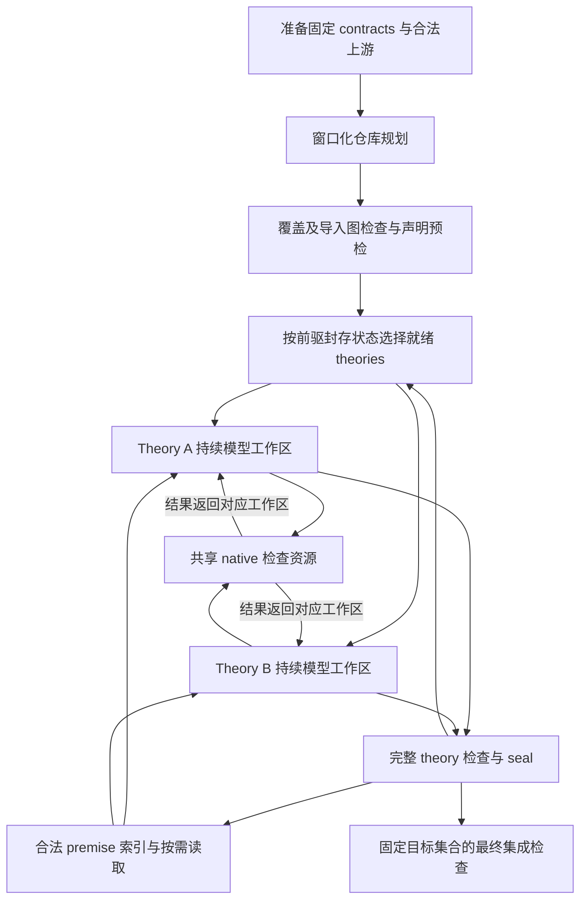

# Repo-level 长程证明生成任务的稳定性研究

本文将论文收敛到一个角度：**在有限上下文下，如何组织相互依赖的证明工作区，使局部进展持续积累为整个仓库的进展。** 重点是仓库任务的上下文与协作管理。helper 拆分属于通用证明难题，在本工作中作为工具辅助的增强项，不再承担主要问题定义。

论文的核心矛盾是：**任务具有全局关联，模型的有效推理范围却是局部的。** 把整个仓库持续输入模型，会使规划信息和探索历史过大；把任务分给独立工作区，又可能丢失任务关系和可复用事实。方法需要同时保留局部上下文的可管理性，以及全局任务和知识的连接。

已有证据以 `refine-astra-medium-20261005-006` 为准。滑动窗口是拟实施增强；非 LLM helper 支持的效果与 CRefine 结果也仍待验证。旧实验中的配置角色名不等于真实独立模型调用，本文按实际控制流介绍协作。

## 1. Repo-level 相比单 lemma、单 theory 增加了什么困难

| 任务尺度 | 需要完成的工作 | 额外管理责任 |
| --- | --- | --- |
| 单 lemma | 在给定合法环境中完成一个目标，必要时设计 helpers | 管理该目标的搜索和局部上下文 |
| 单 theory | 完成一组同文件目标及局部辅助性质 | 维护文档顺序、共享事实和整个 theory 的检查 |
| Repo-level | 在多个相互依赖的 theories 中完成固定目标集合 | 分配全仓目标、确定上下文边界、跨工作区发现知识、协调前驱与就绪任务、检查整体集成 |

单 lemma 也可能依赖大型仓库，单 theory 也可能有长上下文。区别不在于前两种任务绝对没有依赖，而在于本任务需要同时生成和组织多个工作区的成果：下游需要的生成事实可能尚未完成，当前可用上下文受生成状态和 imports 约束，最终还要确认整个指定目标集合完成。

因此，repo-level 不是把单目标生成简单重复很多次。需要回答两个相互连接的问题：

1. **怎样分批理解全仓任务，形成能交给局部工作区执行的计划？** 初始信息规模很大，相关目标可能分散在不同文件中；读取次序和分组选择影响上下文共享与等待关系。
2. **怎样让局部工作区持续获得需要的知识，并可靠地连接其他工作区的成果？** 探索历史和生成事实不断增长，全部广播会扩大上下文，完全隔离又容易重复证明或遗漏已有支持。

这两个问题统一指向上下文组织与工作区协调。证明本身的数学困难仍然存在，但本文主要研究的是如何让相互依赖的长程任务保持有效进展。

### 1.1 “稳定性”指什么

正确性由完整 native 检查和集成证据确认。本文研究的生成稳定性是：在相同合法输入与预算下，规划、上下文选择和工作区切换带来的波动是否减少，已验证成果是否持续被保存与复用，整个目标集合能否较稳定地推进。

计划合法、日志持久或单次覆盖高，均不单独证明稳定性。需要重复实验、过程证据和机制对照。加速也应同时计入模型、检索、检查和集成成本。

## 2. 三个机制分别解决什么问题

| 机制 | 对应问题 | 如何发挥作用 | 要验证的效果 |
| --- | --- | --- | --- |
| 滑动窗口规划 theory | 全仓初始信息过大，自由读取和反复整理会产生规划波动 | 分批提供完整 contract 信息，携带全仓简短目录和累计计划，允许补读与修订 | 规划成本、分组与前驱安排的波动、计划的实际可执行效果 |
| theory 内持续共享工作区 | 局部探索历史变长，分散尝试难以保持当前证明状态 | 同一工作区维护 contracts、helpers、证明草稿与检查反馈，围绕当前目标持续读取和编辑 | 重复尝试、有效进展保留、首次目标完成成本 |
| 全局 premise 索引与召回 | 当前目标所需知识分散在其他 theory/session，全文广播成本高 | 按需检索合法事实，读取完整陈述与来源，在当前环境中检查使用 | 实际事实引用、跨 theory 复用、召回成本与目标完成收益 |

三者形成分层上下文机制：**全仓任务分批理解，相关局部工作集中保存，外部知识按需获取。** theory 工作区是持续存储，不要求每次调用把整份文档及历史都注入 prompt。具体读取与输入规模仍需测量，不能仅凭有工作区就声称消除了长上下文问题。

### 2.1 滑动窗口规划：保留全局视野，限制单次深入阅读规模

初始规划只使用准备阶段的固定 contract 陈述、owned context、合法上游和已有元数据。此时没有执行诊断、实际证明缺口或本轮已生成 helpers。需要更多背景时，调用既有定义读取和 premise 查询接口做初步调查。

窗口是阅读批次，不是强制 theory 边界。全仓简短目录用于发现窗口外目标，累计规划表保留已阅读/已分配 IDs、暂定分组、理由与待比较关系。固定规则组织阅读顺序，模型决定分组与接口；修改已有决定时记录依据，最后进行全局审阅和完整计划检查。

现有 Astra 工作区规划已具备目录、完整声明、查询、`plan.json`、`NOTES.md` 和多轮验证。新增部分是固定阅读批次与结构化规划记忆，首版沿用完整 proposal 的生成、验证和提交，不新增复杂的局部合并协议。代码见 [冻结规划工作区](reports/regen/provider-bootstrap-repair-20261005/resume-application/regen/planning/workspace_planner.py)。

符号相似只能用于组织阅读，不能当作已确认的 theorem 依赖。窗口化也可能带来顺序偏差，需要保留补读和修订能力。计划一致性本身不是质量指标，必须结合后续执行效果。

### 2.2 theory 共享工作区：使局部探索具有连续性

每个 theory 由一个持续模型会话负责。相关 contracts 与 helpers 共处可检查的 `.thy` 文档，模型可以尝试直接证明、添加中间性质、使用已有事实，并根据反馈修订。工作区同时保留草稿和正式接受状态，局部失败后能够继续原有探索。

这里的“共享”首先是同 theory 中多个目标共享证明材料，不是多个模型同时无约束地修改同一文件。Astra 006 每个 theory 一个写入负责者，同一 theory 工具串行，不同 theories 可以并行。模型会话可以采用相同模型；006 使用 Astra medium，不提供异构模型协作优越性的证据。

模型独占局部修改权、source hash 绑定和原子接受减少跨会话写入干扰；正式状态和文档保存已有工作。其作用是提供明确、连续的探索载体，不保证每条证明路线可达，也不保证每个 theory 的模型输入都足够小。

### 2.3 premise 召回：用事实接口连接工作区

局部会话无需阅读其他会话的全部对话，而是按当前目标检索事实，读取陈述、来源和可用状态，尝试实例化与使用。已有 facts 帮助减少重复构造，新成果则在符合接受、seal 和 imports 边界后供后续任务使用。

索引命中不认证适用性。当前 theory 必须满足前提和合法导入条件，最终使用由 native 检查确认。未封存或未导入的生成材料可以作为参考，复制为本地 helper 后须在目标环境重新验证，不能直接作为已成立前提。

“全局”指覆盖实验允许访问的合法事实范围，不包括被移除的目标证明和辅助材料。跨 Isabelle session 使用受冻结上游约束；跨模型会话复用受正式接受状态约束，两种 session 含义需在论文中区分。

## 3. 协作框架如何把三个机制接起来

图中的窗口规划属于拟实施增强；其余主要执行链路已有 Astra 006 依据。事实进入索引后是否能用于某个已启动 theory，仍受其冻结 imports 限制。native 检查器和索引是服务，不是额外推理模型。

协作通过任务、文档和已验证事实组织：规划器分配目标，局部会话负责各自工作区，调度器遵守硬前驱和资源限制，检查器与正式接受记录确定证明权威。无需把全部会话历史相互广播。

保持 theory 为验证和发布单元。未完成目标可能延迟整个 theory 的成果对下游可用，这是工程简单与稳定的取舍；动态拆分发布、自动改写 imports 和复杂运行时全仓重规划不作为本轮核心贡献。

### 3.1 为什么可能更稳定或更快

机制预期是：窗口组织降低初始信息处理的波动；局部持续工作区降低重建和重复探索；召回降低外部全文输入与重复构造；独立负责者和检查边界使协作状态明确。不同就绪 theories 的模型推理可以并行，但 native 检查并发是独立限制。

Astra 006 有两个 theory 会话、一个 native 槽和两个驻留 workers。不能用两个会话推出两倍加速；需要分开测模型时间、检查等待、上下文输入成本和总墙钟。工作区隔离及 seal 也有成本，论文报告其收益与代价。

## 4. 现有实验能支持哪些仓库级证据

### 4.1 实验身份与实际协作方式

Astra 006 沿用 [001 的计划](reports/regen/refine-astra-medium-20260930-001/planning/file-generation-list.json)：287 个 contracts、30 个 theories、48 条 required import edges、7 个 collaboration groups 和7 条 reuse suggestions。只有 required imports 形成硬前驱；建议组不建立证明事实或额外 barrier。

模型为 `gpt-6-astra / medium`。每 theory 的同一 File Planner 会话承担局部规划、helper 创建、proof 和修订；配置中的 Lemma Prover/GRA 名称不意味着每次检查调用独立模型。执行依据见 [并行政策](reports/regen/refine-astra-medium-20261005-006/proof/parallel-workspace-policy.json)、[冻结会话实现](reports/regen/provider-bootstrap-repair-20261005/resume-application/regen/planning/parallel_file_planner.py)。

最终接受 199/287 contracts，885 个 helpers，13 个 theories sealed；起点继承 194 个 contracts，本轮新增 5 个。未接受的 88 个中，66 个从未初始化，22 个在已初始化 theories 中。006 是 continuation，未完成全仓 integration，不能作为从零完整生成或稳定性对照成绩。

覆盖与案例证据：[evidence.json](reports/regen/astra006-long-horizon-analysis-20261012/evidence.json)、[extract_evidence.py](reports/regen/astra006-long-horizon-analysis-20261012/extract_evidence.py)、[运行绑定](reports/regen/refine-astra-medium-20261005-006/proof/run.json)。

### 4.2 局部工作区之间确实存在共享知识需求

最终13 个 sealed theories 的完整 native 审计覆盖173 个 contracts 和732 个 helpers，共905 个 targets：

| 指标 | 结果 |
| --- | ---: |
| 跨 theory named dependency edges / theory pairs | 260 / 17 |
| 直接使用跨 theory 生成事实的 contracts | 30/173，17.3% |
| 沿生成事实依赖链包含跨 theory 依赖的 contracts | 94/173，54.3% |
| 直接使用生成 helper 的 contracts | 119/173，68.8% |
| 沿生成事实依赖链使用 helper 的 contracts | 145/173，83.8% |
| 被至少两个 contracts 直接使用的 helpers | 70 |

`heap_tcb_relation` 被6 个 contracts 使用，涉及6 个 theories；`asid_machine_op` 被6 个 contracts 使用，跨 ASID 与 Mapping。事实共享有实际发生，是仓库任务的实证基础；它尚不证明某个规划或召回策略造成了收益。

数据来自 Isabelle `Thm_Deps.thm_deps` 的命名节点依赖，非源码出现次数；间接指标另对生成事实图计算可达关系。26 个 accepted contracts 位于未 sealed theories，不属于这173 个的完整审计范围。复核：[依赖分析](reports/regen/astra006-repository-reuse-20261013/analysis.json)、[脚本](reports/regen/astra006-repository-reuse-20261013/analyze.py)。

### 4.3 召回参与证明，但因果收益仍需验证

006 两个活动 theory 会话中，有56 个 standalone queries 和21 个 observe 内 query 子动作，合计77 个 query actions，以及2 个事实读取动作。一次动作可能含多个查询串，不等于一次成功检索。

累计 query index 的909 个召回 premise canonical names、102 个召回生成事实与 native 依赖重合。该交集不证明检索先于使用，也不全部属于006 的新增调用。一个直接轨迹是 Scheduler 主会话第479 行返回 `Finalise_AI.gts_wp`，最终 accepted activateThread proof 使用 `wp gts_wp`。该 theory 尚未 sealed，这是过程与接受证明的对应，不是完整 theory 审计。

## 5. 怎样评价稳定性与效率

### 5.1 两次独立 session 实验

Refine 与 CRefine 分别冻结 contracts、合法上游、证明移除规则、运行身份和成本账本。**CRefine 使用冻结、已验证的既有 Refine 上游，不使用本工作生成的 Refine 成果，也不等待 Refine 生成实验完成。** 两次实验内部可以跨 theory/session 使用合法事实，但不是联动生成两层验证链。

CRefine 的 adapter、sanitized packages 和 native 验证路径仍需准备与确认；其目标数与结果不能照搬 Refine。每次任务的“完整成功”均要求规定的全部目标闭合、theories 完整检查和最终集成通过。不得通过历史、索引或检索重新引入禁止的目标证明或被移除辅助材料。

### 5.2 围绕主线收敛实验问题

| 研究问题 | 主要比较 | 主要指标 |
| --- | --- | --- |
| RQ1：仓库是否持续推进，效果是否稳定？ | 相同输入、模型和预算下重复完整运行 | 覆盖随成本的曲线、最终覆盖分布、sealed 数与集成状态 |
| RQ2：窗口规划是否改善上下文组织？ | 当前自由读取与窗口化规划 | 规划成本、实际输入规模、分组/前驱波动、后续执行效果 |
| RQ3：持续工作区和召回是否改善协作？ | 可比的状态保留与召回对照 | 重复尝试、首次目标完成成本、事实实际引用、跨 theory 复用 |
| RQ4：非 LLM helper 支持是否有附加收益？ | 相同主框架下启用/关闭工具辅助 | 候选筛选成本、困难 contract 完成率、端到端成本 |

前三项是核心实证，第四项是增强实验。规划重复与证明重复分开：前者固定初始输入重复规划，后者固定计划重复证明。关注成功分布与较差运行表现，避免只报告最好的一次。理论分组一致但执行差，不算稳定性改善。

成本分开记录模型、检索、native 检查、资源等待及集成，并报告首次产出和达到给定覆盖的成本。部分检查错误属于基础设施，部分目标未执行；`not_reached`、直接失败和未初始化分别报告。受控恢复可作为状态连续性的补充测试，当前证据不支持任意主机故障恢复保证。

已有 Vero/Codex 案例结果见附录A，只提供困难背景。模型、继承起点、投入和目标是否到达不同，不能作为主框架稳定性或加速的公平对照。

## 6. 增强项：非 LLM 工具辅助 helper 设计与筛选

helper 设计是证明生成中的长期难题。本文保留它作为局部证明能力，重点考虑让工具承担可机械处理的部分，减少模型任意猜测和重复投入；不要求解决所有抽象发现问题来支撑仓库主线。

| 可考虑的手段 | 非 LLM 部分负责什么 | 仍需模型或完整证明解决什么 |
| --- | --- | --- |
| 从真实残余目标提取候选 | 由 prover 状态保留参数、类型和局部假设，生成对应子义务候选 | 哪些义务值得独立封装，以及怎样形成可复用抽象 |
| 规范化与已有事实匹配 | 对候选做项级规范化、去重、已知事实匹配 | 语义等价和复杂蕴含不能靠字符串或符号相似认证 |
| 有限自动化预检查 | 尝试受预算限制的 simp、算术或已有规则，得到实际证明结果 | 自动化未完成的目标仍需进一步推理；超时不是反证 |
| 反例检查 | 对适用候选用 Nitpick 等寻找反例，提供修订信号 | 无反例不代表成立，潜在/近似反例需按工具结果区分 |
| 父目标使用检查 | 尝试将已证明 helper 接入真实目标，记录剩余义务 | helper 成立不保证父目标完成；缺失条件和路线改变仍需判断 |

建议首版优先做**真实子目标提取、规范化去重和有预算的自动化预检查**，在现有文档/checker 链路中提供候选与证据。候选必须来自真实、版本绑定的 prover 状态，保留所有必要假设，重新检查独立声明，最终仍由完整 proof 和 theory 审计确定成立。

提取子目标不自动产生更好的抽象：如果将原目标换个名字，或携带目标中无法获得的额外假设，仍没有改善证明。候选需绑定服务目标和预期用法；工具反馈可以辅助模型选择，而不能把未证明 helper 当作 premise。

Isabelle 的 [Nitpick 官方手册](https://isabelle.in.tum.de/doc/nitpick.pdf)说明其反例搜索能力；它不是证明器，搜索范围内无反例不能替代证明。只有确认当前环境支持且适用的工具才纳入实验，并将预检查成本计入总投入。

代码现状需区分：项目的 [automation_advisor.py](regen/planning/automation_advisor.py)包含规则匹配和自动化候选建议，不等于自动 helper 发现；[helper_selection.py](regen/planning/helper_selection.py)保留历史 AND/OR 成本搜索代码，但当前控制器已停用 `select_helpers`，不能写成活动基线的能力。旧路线估计还依赖模型输入。此次文档更新没有启用该策略，也没有实现以上新工具链。

helper 详细成本、消费者与失败案例已有独立文档：[HELPER-CASE-STUDIES.md](reports/regen/astra006-long-horizon-analysis-20261012/HELPER-CASE-STUDIES.md)。主文只选少量例子解释工具辅助的作用，不展开全部数学证明路径。chooseThread/activateThread 展示组合和性质传播；deleteObjects 展示中间性质发现；schedule/reset 展示局部成果尚未兑现为目标闭合。各自证据仍见 [evidence.json](reports/regen/astra006-long-horizon-analysis-20261012/evidence.json)。

## 7. 论文故事、贡献与结构

### 7.1 引言主线

> Repo-level 长程证明生成需要同时完成多个相互依赖的证明工作区。与给定环境中的单目标或单 theory 生成相比，系统还必须组织全仓任务、持续选择局部上下文，并让分散产生的证明成果在合法边界内被复用。全文输入使上下文与历史不断增长，独立工作区又可能丢失关联知识。我们围绕这一矛盾构建分层上下文与协作框架：窗口化规划组织初始任务，持续 theory 工作区保留局部进展，全局 premise 召回按需连接外部知识，检查与封存机制确认成果和整体完成。我们在独立的 Refine/CRefine 任务中评估覆盖、成本与重复运行的稳定性，并进一步考察非 LLM helper 支持的附加收益。

这是拟完成工作的介绍逻辑，不是对当前结果的结论。题目强调稳定性，最终须有重复实验和机制对照；尚无此证据时，应报告框架能力与已有仓库复用，避免把预期收益写成已验证效果。

### 7.2 三项贡献

1. **面向 repo-level 长程任务的上下文与协作框架。** 将全仓任务组织、局部工作区和事实共享连接起来，明确多会话的任务负责者、可用上下文与验证边界。重点是仓库推进，不将通用 helper 分解当作主要差异。
2. **分层上下文机制及其稳定性、效率评估。** 窗口规划、持续工作区和全局召回分别处理全仓阅读、局部状态与外部知识，研究它们对波动、重复工作和成本的影响。组件存在本身不构成收益证据。
3. **Refine/CRefine 独立任务与可复现实证。** 公开合法输入边界、harness、运行配置、生成产物及过程证据，分别报告整体覆盖和集成；非 LLM helper 辅助作为框架增强与附加实验，按实际实现描述。

### 7.3 推荐结构与取舍

| 章节 | 保留的重点 |
| --- | --- |
| Introduction | repo-level 相比单 lemma/theory 的差异，上下文与协作矛盾，贡献 |
| Background and Problem | 固定目标、合法 facts、工作区边界、规定目标集合完成与稳定性指标 |
| Method | 窗口规划、持续工作区、全局召回和验证交接；简述非 LLM helper 增强 |
| Experimental Setup | 两个独立 sessions、证明移除边界、模型、预算、对照与重复设计 |
| Results and Analysis | 核心RQ、跨 theory 复用、稳定性与成本；少量 helper 增强案例 |
| Related Work | 单目标/单 theory 证明、仓库上下文、协作规划；helper 发现与工具辅助 |
| Limitations and Conclusion | 规划和检索误差、未完成目标、资源和状态边界 |

运行恢复细节、全部工具协议、角色历史、所有 helper 的数学路径和成本明细留在附录或开源资料。主文每个机制都解释“处理哪类上下文、怎样连接工作区、哪项实验验证作用”，不追求覆盖项目的所有功能。

## 8. 文献与证据边界

[VeriSoftBench，2026](https://arxiv.org/html/2602.18307)保留真实仓库上下文和跨文件依赖，并比较相关上下文与全仓上下文。它支撑上下文组织的重要性，但任务仍是从仓库抽取的证明义务，不能把它的实验等同于同时生成完整证明项目。

[Co-Coder，2026](https://arxiv.org/html/2606.00953)讨论仓库代码任务中分组、依赖和跨 agent 协调成本，提供工作区划分与协作的设计启发；其代码生成收益不直接证明本框架的证明生成收益。[Stepwise，2026](https://arxiv.org/html/2603.19715)提供系统证明中的多步探索背景，但局部搜索结果不能代替仓库上下文机制的消融。

helper 背景可引用 [Goedel-Architect](https://arxiv.org/abs/2606.06468)、[IDS](https://arxiv.org/abs/2605.23109)；[LEGO-Prover](https://arxiv.org/abs/2310.00656)是较早共享 lemma 库参考，非2026新论文。这些工作解释分解与复用的相关方向，本文主张仍由自身实验支持。

原始过程入口：[Scheduler 会话](reports/regen/refine-astra-medium-20261005-006/proof/parallel-sessions/60ea84ad16ab439ba102b3a49fc88a8a/Scheduler_Dispatch/session-transcript.jsonl)、[Untyped 会话](reports/regen/refine-astra-medium-20261005-006/proof/parallel-sessions/60ea84ad16ab439ba102b3a49fc88a8a/Untyped_Object_Lifecycle/session-transcript.jsonl)。模型叙述用于解释策略，checker 和正式接受记录确认结果。

## 附录 A. 历史 Vero/Codex 选定目标比较

### A.1 核查范围与结果

此前只读核查机器 B 上两个指定运行，并读取旧 Codex Astra 档案。以正式 acceptance 或 Vero evaluation 为准，不用模型声称“完成”的文字代替验证。

| contract | Astra 持续文档 006 | Vero Sol 48h 004 | 普通 Codex Sol 009，续接 007 | 旧 Codex Astra 档案 |
| --- | --- | --- | --- | --- |
| activateThread_corres | accepted | open；评估 unfilled | 未 accepted，无目标 batch 记录 | 未 accepted，theory 未初始化 |
| chooseThread_corres | accepted | open；评估 unfilled | 未 accepted，无目标 batch 记录 | 未 accepted，无目标 batch 记录 |
| deleteObjects_corres | accepted | open；评估 unfilled | 未 accepted，13 次目标直接 failed | 未 accepted，无目标 batch 记录 |
| schedule_corres | 未 accepted | open；评估 unfilled | 未 accepted，无目标 batch 记录 | 未 accepted，无目标 batch 记录 |
| resetUntypedCap_corres | 未 accepted | open；评估 unfilled | 未 accepted，无目标 batch 记录 | 未 accepted，无目标 batch 记录 |

“持续文档化解决的 contract”在这里准确指：持续文档运行接受的案例，而不是已经通过消融证明由文档化这一组件导致成功的案例。

Vero 路径：`/data/zljj/vero-a-unified/vero-active-wall-sol-20261010-004/vero-sol-medium-active-wall-48h-004`。最新 `result.json` 为 `stopped / active_wall_budget_reached`。`run/iterations.json` 指定的 best iteration 为 004；该评估证明 13/287 个 specs，所选五项均为 `unfilled`，iter-006 的选定目标结果相同。不能沿用较早暂停快照中的 12 个 green 作为最新最佳评估数量。

Vero 的目标映射为 activateThread `c0217`、chooseThread `c0148`、deleteObjects `c0060`、schedule `c0161`、reset `c0252`。其 summary 中 Schedule 模块有 45 条检查记录，目标列表包含 chooseThread/schedule，outcome 为 44 次 `ok`、1 次 `build_error`。但最佳评估仍将两项目标标为 `unfilled`，因此 module 检查的 `ok` 不能算作这两个 contract 的证明成功，也不能把 45 次都算作本体尝试。Tcb、Detype、Untyped 三个对应模块的检查记录为 0。因此至少这些后三模块的未完成不能解读为“充分尝试后证明失败”。此外，iterations 元数据记录 `formal_takeover_count=3`，本文仅报告现存评估结果，不把 13 个 specs 当成已核清干预来源的全自动横向成绩。

普通 Codex 路径：`/data/zljj/vero-a-unified/codex-active-wall-sol-20261012-009/codex-sol-medium-active-wall-48h-009`。这是 007 的延续，模型为 Sol medium，接受状态和历史成本继承；此次读取当前 commits，五项均不在 accepted order。其中 deleteObjects 在请求 1、2、4、6–15 的 `node_results` 中共 13 次直接 `failed`，是目标级失败证据；其余四项没有相应 batch history 或已接受 proof records。对应 modules 的其他历史不能归到这些目标。目标相关记录保存在下面的快照中。

旧 Codex Astra 档案来源为 [contract-statistics.json](reports/regen/restart-readiness-20261006/history/contract-statistics.json)，其累计结果是 130/287，包含历史重规划和恢复，与本地 006 的 199/287 不是同一运行投影。上述四项没有 batch membership，activateThread 所在 theory 未初始化。它提供“该档案中尚未接受”的事实，不提供这些目标上同模型的失败对照。[选定条目](reports/regen/astra006-baseline-contract-comparison-20261013/old-codex-astra-selected.json) 已另存，便于核查。

复核材料：[机器 B 结果快照](reports/regen/astra006-baseline-contract-comparison-20261013/remote-snapshot.json)、[只读采集脚本](reports/regen/astra006-baseline-contract-comparison-20261013/extract_remote.py)。快照记录读取时刻、commit 身份、报告与源文件哈希；普通 Codex 运行还可能继续推进，因此结果仅代表该快照。采集时没有启动、恢复或修改任何生成实验，也未穷举全部历史 Vero/Codex 运行。

### A.2 比较结果的限制

可以报告：**Astra 持续文档运行接受了这三个困难案例，所核查 Vero/Codex 快照尚未接受它们。** 不能由此推出文档化造成了优势。主要混杂包括模型不同、继承起点不同、theory 组织与推进顺序不同、输入上下文和总投入不同，以及部分基线尚未到达所选目标。

更有说服力的对照应在相同前序接受状态上，把这些困难 contracts 分别交给持续文档和对照策略，固定模型、合法 premises、native 并发和总预算。除了最终成功率，还应记录：消费者组合检查次数、接口修订、helper 在父证明中的实际依赖、到首次父目标闭合的成本，以及未到达/未执行目标。

如果要单独评估持续文档机制的价值，可比较：只证明 helpers 的策略，与持续保留消费者 proof、依据残余目标修订接口的策略。保留相同检索能力，避免把召回收益误计为文档收益。helper 数量、局部 green 数和长对话本身均不构成效果指标。
