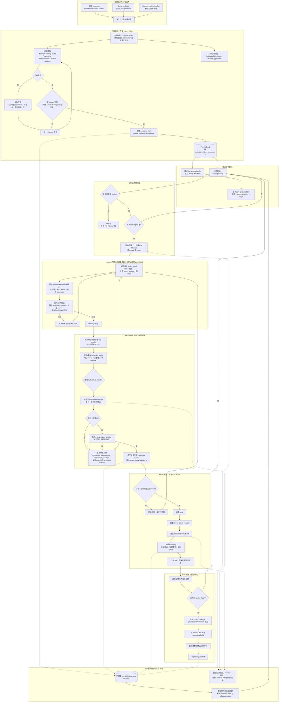

# 当前仓库级证明生产完整流程

本文描述默认 `document` / theory 源码工作区路径。仓库级 theory DAG 是规划、调度和
认证成果发布结构；theory 内不要求 File Planner 维护 proof/helper DAG，`.thy` 源码顺序是
探索状态的权威表示。旧 graph/GRA 接口仅用于兼容与历史回放。

## 图结构边界

- **保留且必要**：仓库级 theory DAG。硬边来自 imports/provider-consumer 依赖，决定
  readiness、并发、sealed 成果发布、恢复和最终构建顺序。
- **不作为默认 Agent 状态**：theory 内 proof/helper DAG。File Planner 直接维护 `.thy`，
  新增 helper 和失败驱动的策略修订都由同一持续 Agent 完成。
- **允许内部派生**：checker 可从源码顺序、实际 theorem dependencies 和审计证据生成声明
  依赖信息，用于失效、`blocked` 归因和复用统计；它不是要求模型同步维护的第二事实源。
- **软关系不变成硬边**：reuse suggestion 或 collaboration group 不应自动阻止 theory 启动；
  只有真实 imports/逻辑前提形成 DAG 硬边。

## 当前实现与计划改进的边界

当前检查按源码顺序运行并在首个 Isabelle 异常处停止，整批通过后才原子接受；因此失败反馈
可区分已执行未提交、首个失败和未到达项，但不会继续验证失败点之后的独立 proof。计划中的
多结果事务检查将在同一冻结上下文和常驻 worker 中继续验证独立改动，逐项返回 GREEN、RED、
blocked 或 not_checked；该计划不改变 theory DAG、seal 或最终仓库验收边界，也不得用 `sorry`
代替已认证证明。
