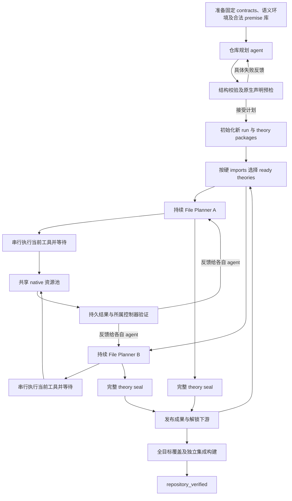

# 从仓库规划到集成验收：跨 theory 并行、单 File Planner 串行

更新：2026-09-25。适用入口：`proof_session_runner parallel-workspace`。
本文件是当前控制流和模块 TODO 的主说明，取代此前“单 File Planner 内部异步观察/检查重叠”的设计。历史实验及验收报告保留当时的行为，不用于定义当前接口。

## 1. 当前约定

- 每个活跃 theory 分配一个持续 File Planner，由它独占本 theory 的修改权。
- 一个 File Planner 内部所有正常工具串行：模型决定 → 工具执行并完成 → 返回结果 → 模型继续。检索、声明、符号、证明 batch 和 seal 均遵守此规则。
- 不同 theory 的 File Planner 可并行；只有硬 `required_imports` 约束启动顺序。协作组、复用建议及 theory 数组优先级不是额外 barrier。
- 默认使用持久 theory 源码工作区；一次编辑多个 contract/helper，按文件顺序验证全部已填写证明，整版成功后原子接受。模型不维护局部依赖图。
- 不按失败次数或时间片强制 agent 让出 theory，不限制探索性 helper 数量或数学提案修正次数。
- 模型按当前配置采用 `gpt-6-astra / medium`，执行资源与模型会话数分别管理。
- 环境内容由操作者保证实验期间不变，不实现父源码/heap/工具链的运行时内容冻结。保留路径可用性、数据库完整性、固定 contract 与证明证据校验；已有环境摘要作为来源记录兼容旧产物。
- 本阶段以正常工作流程为验收对象。SIGKILL、主机故障、外部资产修改等防御性恢复不是当前必需条件；受控退出和已有持久日志继续保留。

## 2. 总流程



普通读取和 SQLite 检索不必占用 native 槽；只有实际调用 Isabelle 的部分需要申请槽位。任务执行器可以使用后台线程，但正常工具调用会等待该任务终态，agent 不会同时开展本 theory 的下一项操作。

## 3. 阶段目标、产出与验证

<a id="m0"></a>
### M0：准备输入与运行环境

代码：`preparation/checker_context.py`、`planning_input.py`、`premise_database.py`。

输入是固定目标 contract 集合、经过清理的语义环境、允许使用的父 session 事实。生成 repository planning input、合法 premise SQLite、checker 配置。原始 theory 名称可按 source-visible 策略公开；原始目标证明、删除的 helper 及其证明不进入生成上下文。

验证事实来源、session/theory 归属、语句与原生导出证据；来源无法确认的事实隔离。数据库完整性继续校验。环境内容稳定由人工负责，不额外加入环境冻结服务。

<a id="m1"></a>
### M1：仓库规划

代码：`planning/workspace_planner.py`、`workspace_harness.py`、`import_contract.py`。

agent 负责把全部 contracts 重新划分到职责清晰的 theories，提出分组理由、硬 imports、ready theory 优先级、辅助引理意图及复用建议。

原始 owner_theory 是参考元数据，不要求保持原归属。此阶段不生成具体证明，不需要 proof-state 检索；可以按名称、定义和概念查找合法 helper/lemma。

产出为 repository plan 及每个 theory 的 projection。模型负责架构判断，结构 PASS 不代表分组质量最佳。

<a id="m2"></a>
### M2：规划验收

代码：`planning/workspace_validation.py`、`workspace_preflight.py`、`workspace_harness.py`。

程序检查：contract 恰好覆盖一次、引用合法、theory 名称唯一、硬 imports 无环、固定 statement/context 未被替换。原生预检按计划 imports 装载声明，以 `oops` 结束，不产生已证明事实。

失败反馈返回规划 agent 继续修订，不设数学修正次数上限。显式 submit 绑定通过校验的精确计划与预检证据，过期或损坏的证据不能接受。

<a id="m3"></a>
### M3：初始化与调度

代码：`execution/repository_execution.py`、`planning/parallel_file_planner.py`。

初始化新 run，保存计划与固定目标绑定、模型/代码配置和每个 theory 的 package。执行入口校验派生 files 与已接受清单一致，避免遗漏 theory 后只验收目标子集。兼容计划可以沿用；不继承历史证明的从零实验须创建新 run。

调度器按 required_imports 选择已满足 provider seal 的 theory，最多启动 `max_parallel_theories` 个持续 agent。ready theory 按计划顺序分配；完成一个即可补位，不等待同批其他 theory。

只有一个运行协调者；每 theory 一个控制器和工具串行锁，journal 与共享投影使用短事务。各 theory 具有独立的可写构建目录与 heap 副本，避免 ROOT、日志或构建输出相互覆盖。

配置 `theory_tool_execution: serial` 写入根 policy 和各 theory session policy。旧运行的配置不被静默修改。

<a id="m4"></a>
### M4：单 File Planner 的持续源码工作区

代码：`planning/theory_document.py`、`parallel_file_planner.py:TheoryController`、
`batch_file_planner.py`。详细格式与验证边界见 [源码工作区](THEORY-SOURCE-WORKSPACE.md)。

1. `read_theory` 返回持久 `.thy` 草稿、source hash、已接受条目和最近反馈。
2. `proof_action(edit_theory)` 按 base hash 精确替换文本或保存全文件。固定声明、上下文、
   imports 和目标覆盖受保护；保存不运行 Isabelle，也不产生 GREEN。
3. 模型可连续编辑、添加/删除/重排 helper，一次填写多个证明；失败草稿继续保留。
4. `proof_action(check_theory)` 校验指定草稿版本，在共享 native 资源池中检查全部已填写
   证明。文件顺序决定可见性；未完成的 `oops` 槽不进入证明源、不产生可引用事实。
5. 未改变的已验证前缀可以热复用；改写、删除或重排已证明声明时，重新验证当前所有已
   填写证明。新版本原子接受，失败保留原已接受版本与当前失败草稿，历史证据不删除。
6. 模型根据反馈继续编辑或检索。草稿与成功接受的版本完全一致、全部目标及保留 helper
   完成后，`proof_action(finish)` 执行完整 seal。

不要求模型输出 dependencies、consumers、routes 或证明 DAG。helper 是文件里的普通
lemma。内部声明索引保留固定身份、文件顺序及证据，不把文本先后关系宣称为数学依赖。
实际定理引用由 Isabelle 审计；跨 theory 仅由 required_imports 派生循环检查与就绪状态，不另维护调度图。
协调器启动 File Planner，agent 的 list_workspace 只读状态，不承担跨 theory 派发。
文档初始化/候选由 `declaration_index.py` 构建和校验；旧 graph/nodes 仅是 journal/checker
兼容编码。源码接口拒绝旧图修改和闭包导入动作，跨 theory helper 通过读取源码、复制/改写及目标复验复用。

默认 `--file-planner-interface document`；`graph` 仅兼容旧接口，不可静默切换旧 run。
查询、符号解析、历史诊断以及跨 theory 成果读取继续可用。单 theory 所有工具保持串行，
不同 theory 并行；保存草稿不占 native 槽。旧 submit_check/get/wait/cancel 接口保留供兼容
控制，但默认源码 agent 不接收这些图检查工具，也无需轮询。

<a id="m5"></a>
### M5：检索与共享成果

代码：`execution/file_planner_recall.py`、`proof_state_recall.py`、`shared_proof_workspace.py`、`planning/planner_workspace.py`。

父 session 合法事实来自 SQLite；已 import 的 sealed theory 成果来自绑定的合法前提记录；当前 theory 的 GREEN 直接在工作区中提供。agent 可按名称、定义、完整目标或真实失败 proof state 检索，显式选择并阅读完整声明/证明样例。

未 seal 或未 import 的他 theory 成果只能作为参考。源码模式使用 `list_generated/read_generated` 读取绑定提交的源码，复制/改写后必须在目标 theory 重新检查；旧 `prepare_reuse` 闭包接口仅供 graph 模式。失败尝试可供策略参考，不能作为事实。

本 theory 检索串行返回，无后台观察与下一次证明争写工作记忆。观察结果先保存在 task 收据，读取时投影为工作记忆，下次证明动作合入 journal；这不增加证明决策计数。现有记忆 reducer、查询缓存和旧 task 顺序字段仍用于恢复兼容，不代表继续开放内部并发。缓存命中必须满足查询上下文身份及结果摘要验证。

跨 theory 的共享读取仍要使用一致的已发布提交快照，因为其他 theory 可继续写入。只读共享操作不修复或改写源 theory 的 HEAD。

<a id="m6"></a>
### M6：Isabelle 检查与资源

代码：`execution/check_executor.py`、`check_tasks.py`、`isabelle_node_checker.py`（默认声明接口 `check_declarations`）、`batch_checker.py`、`persistent_checker.py`。

任务先记请求、后执行，结果先落盘、后返回。执行器容量与活跃 theory 数匹配；同 theory 的所有任务使用相同 owner，不能重叠执行。全局 native 槽独立限制实际 Isabelle 操作数，FIFO 排队；每个 native 进程显式配置线程数。

热前缀可复用，闲置进程计入 resident_limit；淘汰关闭成功后才移除登记，失败时保留占用。冷检查/build 前关闭冲突的热前缀。读任务仍可使用独立 checker/output 隔离，串行化不改变其合法上下文。

不同 theory 的 proof、statement、symbol、seal 可以在 native 槽允许时重叠；同 theory 的这些操作不重叠。batch 中多个证明仍是有序验证，并非每节点启动一个 worker。

<a id="m7"></a>
### M7：验证与版本接受

代码：`planning/theory_document.py`、`execution/repository_execution.py`、`proof_batches.py`。

草稿不是证明权威。检查绑定精确源码、固定 package、旧接受状态、实际 imports 与原生
证据。`document` journal 事件独立复编译源码并验证全部绑定；改变旧证明时使用空证明
前缀的完整检查，不能用旧 GREEN 或一个局部检查冒充整版有效。

固定 contract 必须精确覆盖，statement/context 不变，声明名称唯一；证明中禁止 admission、
任意 ML/隐藏顶层声明。候选 helper 的数学有效性交给 Isabelle，不以“看似同义/可疑变量”
启发式拒绝源码模式。完整失败版本不部分接受。旧 graph 模式的 GREEN 不可变规则保持兼容。

外部生成成果先作为参考；只有正式 seal 且在当前 imports 中才成为可直接引用的前提。
复制到本文件的 helper 是新候选，必须经过本文件正常验证。

<a id="m8"></a>
### M8：Seal、终止与资源回收

代码：`planning/batch_file_planner.py:seal_theory`、`planning/parallel_file_planner.py:run_theory_session`。

seal 的输入是全部保留声明已有已接受 proofs 的精确 theory。顺序执行完整 theory 检查、语义/依赖审计和 generated session build。任一步失败，返回具体诊断，保留已接受进展，让 agent 继续修订；不得提前解锁下游。

成功后提交 seal、发布精确源码及合法事实。agent 应结束本 theory，会话返回后控制器关闭检查进程并释放执行槽，调度器补位。seal 成功的时点与模型会话结束的时点分别记录。

| 对象 | 成功 seal 后 | 未完成/运行错误后 |
|---|---|---|
| 工作记忆 | 保存最终摘要，释放内存 | 保存已有状态与原因 |
| 证明成果/journal | 保留并发布，允许合法下游 import | 保留已接受 GREEN，不伪装 sealed |
| 模型会话/native 进程 | 会话结束后关闭并释放资源 | 受控退出时取消任务、关闭并释放资源 |
| 调度状态 | theory sealed，可解锁依赖 | theory 未完成，其硬依赖后继不能启动 |

普通证明失败不终止 File Planner。模型主动结束但未 seal 时如实报告未完成；本轮调度不自动无限重启同一 agent。强杀后的孤儿进程自动回收暂不实现，运行前由人工处理残留资源。

<a id="m9"></a>
### M9：仓库集成

代码：`execution/repository_integration.py`。

全部固定目标所在 theories seal 后，重新读取已接受提交，核对全集 exact-once 覆盖、声明/context、精确源码、实际 imports 和 seal 证据。遗漏/retired 不能掩盖固定目标未完成。

生成独立 integration manifest、ROOT 与输出目录，统一构建最终 theories，不复用旧生成 heap 充当此次构建证据。成功后保存 repository_verified 收据；检查或构建失败则明确报告 integration_failed。

只执行 `--theory` 子集时，子集 sealed 不等于全仓成功。只有全集 gate 通过，才能报告原任务完成。

<a id="m10"></a>
### M10：日志与结果解释

代码：`infrastructure/progress_events.py`、`workspace_transcript.py`、`codex_workspace_session.py`。

记录模型调用、工具开始、native 排队/开始/结束、结果落盘、提交、seal 和集成。日志绑定 run/theory/task，无周期心跳。前端无显示时可以检查持久事件与任务收据。

保留模型工具调用审计及提交来源验证。不要将任务终态、Isabelle verdict、journal commit、theory seal、repository_verified 混作同一结论。

## 4. 配置、入口与产物

```bash
python3 -m regen.execution.proof_session_runner init \
  --dataset-root /path/to/dataset --run-dir /path/to/new-run --run-id new-run

python3 -m regen.execution.proof_session_runner parallel-workspace \
  --run-dir /path/to/new-run --file-planner-interface document --max-parallel-theories 2 \
  --native-slots 2 --native-threads 4 --resident-limit 2 \
  --allow-external-call
```

以上资源数为示例，不代表已完成 RSS/CPU 校准。`max-parallel-theories` 是 agent 数；`native-slots` 是全局同时执行的 native 数，单 File Planner 内部始终串行。`--theory NAME` 可重复指定子集。执行实现变化需要新 run 或已有的显式兼容延续流程，不改写旧实验。

| 相对 run 路径 | 内容 |
|---|---|
| `run.json`、`execution-input.json`、`packages/` | 运行配置、目标全集与各 theory 输入 |
| `parallel-workspace-policy.json` | theory 范围、串行工具策略与并行资源 |
| `parallel-sessions/<session>/<theory>/` | 持续 agent 的审计、事件、结果 |
| `check-tasks/<task>/` | 请求、状态、结果、完成收据及检查日志 |
| `theories/<slot>/document/` | draft.thy、内容寻址草稿版本、经审计编辑记录 |
| `theories/<slot>/declaration-index.json`、`progress.json` | 可重建的声明/文档进度视图，entry 命名 |
| `theories/<slot>/acceptance/` | 声明/证明版本与 GREEN/seal 的权威提交 |
| `generated/`、`sealed-premises.json` | 已发布源码及合法前提投影，具体前提文件位于 theory 上下文 |
| `integration/`、`repository-verification.json` | 全仓集成证据与最终结果引用 |

## 5. 当前验收与 TODO

| 模块 | 本阶段实现 | 后续工作 |
|---|---|---|
| M0 | 人工保持环境稳定，合法数据来源与完整性校验 | 不增加环境冻结功能 |
| M1–M2 | 分组/硬 imports、精确覆盖、原生声明预检 | 实际分组质量与复用成本评价 |
| M3–M4 | 多 theory 持续 agent、完成即补位、单 theory 工具串行、源码编辑/批量验证 | 两个真实 File Planner 从零实验 |
| M5 | 检索、显式选择、共享成果读取与目标复验 | 索引仍扫描 journal 前缀，后续评估增量化 |
| M6 | native 容量、隔离、热前缀、正常取消和关闭 | 真实负载 RSS/CPU 校准；强杀恢复延后 |
| M7–M8 | 原子完整 batch、完整 seal、已接受 journal 恢复 | 未接受 raw check 的独立重提交协议延后 |
| M9 | 全集覆盖及独立统一构建 gate | 实际小目标从零生成到最终集成实验 |
| M10 | 阶段日志及工具/模型审计，无心跳 | 完整模型/检索/native/seal 成本对照 |

串行边界回归验证：工具返回时已终态且有结果；同 theory 的检索、proof、直接读取不重叠；不同 theory 控制器仍可重叠；同步取消不接受迟到 GREEN；重复读取不重跑；观察记忆恢复及检索缓存可用。成功 proof 的 Python 测试使用合成 native evidence，不冒充真实证明。

完整模型生成、真实 native 检查、Python 回归是三类独立证据。测试结果与最新实现映射见 [实现记录](../implementation/PARALLEL-PIPELINE-IMPLEMENTATION.md)。


### 名称与串行/并行边界

默认接口使用 context_entry_id/entry_ids/entry_results；名称适配在 document_interface.py，
不修改实际目标 ID 或证明源。文档观察记忆使用 observation_memory.py；async_* 只兼容
历史状态。底层执行器使用线程池，但单 theory 工具要等待终态，检索不是 agent 可交错
调用的异步任务。跨 theory 可以并行；native_slots=1 时 Isabelle 仍排队，resident_limit
及 imports 就绪也会限制实际并发。list_workspace 分开报告单 theory 写入者数量、File
Planner 容量和 native 槽数。详细命名映射见 [源码工作区](THEORY-SOURCE-WORKSPACE.md#接口命名与并发一致性复核2026-09-25)。
