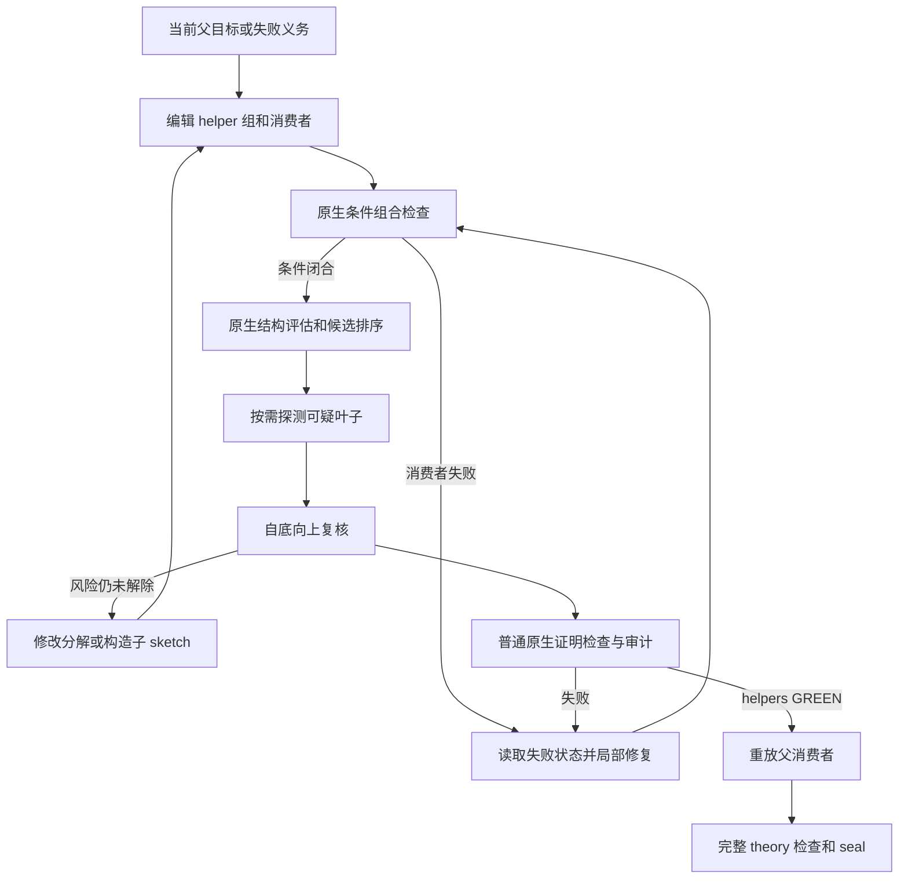

# Helper 分解的评估与局部修复方案

本方案用于固定合同的 Isabelle 证明生成：先检查 helper 组是否足以完成父目标，再筛选未解决的最难义务，优先修复已有证明，最后逐层解除临时假设。新增实验策略为 `sketch-guided-v1`；当前默认仍为 `sketch-reviewed-v1`，历史发布和运行绑定保持原策略。

本轮实现了原生结构观察、候选快照排序、风险叶子准入、具体泛化机制检查和失败记录读取。结构观察与实际原生证明共同约束准入；结构分数和模型的泛化说明都不是数学难度证书。小范围测试的证据见文末。

## 证明路线与接受边界

候选始终包含精确的 helper 陈述组、可执行父消费者和覆盖全部 helpers 的 `use_sites`。一个 edit 可以更新多个目标，每组可以包含多个 helpers；不新增 AND/OR 搜索图，也不以 `helper_purposes` 作为接受依据。



条件组合检查只证明 `Γ,H₁,…,Hₖ ⊢ G`。helpers 在各自合法 GREEN 前缀中证明，不临时假设尚未证明的兄弟。只有普通检查和审计才能发布 GREEN；评估、探测、复核及父消费者条件闭合均不发布事实、不更新成功额度。恢复父证明仍须执行实际检查，完整 theory 的 seal/build 保留。

## 接口顺序

| 动作 | 输入与输出 | 强制边界 |
| --- | --- | --- |
| `edit_theory` | 完整源码或精确替换，附 helper 组和 use selectors | 新 helper 必须有父消费者；合同陈述和上下文保持不变 |
| `check_sketch` | 当前源码 hash，可选择多个父目标 | 精确消费者必须在临时 helpers 下完整闭合 |
| `read_sketch` | 原生 receipt 的完整视图 | 查看实例、局部假设、目标和未实例化变量 |
| `assess_sketch` | 当前源码 hash，可选择多个父目标 | 每组须有当前条件闭合；有子分解时自底向上评估 |
| `probe_helpers` | 明确选择少量叶子 | 独立合法前缀，候选限时 10 秒；失败不是不可证结论 |
| `review_sketch` | 精确 receipt、完整 helper 复核 | 风险叶子须有成功原生探测或经复核的子分解 |
| `read_failure` | 保存的 failure ID | 返回原始失败证明、完整 checker 证据、当前性及修复对象 |
| `diagnose_failure` | failure ID、分类、具体修复计划 | script/known_fact 类必须先尝试改变现有证明并原生重验 |
| `check_theory` | 可选择多个 proofs | 只有完整的审计 GREEN 证据允许提交 |

`assess_sketch` 和探测通过既有 controller、任务执行器及 native 资源槽执行，纳入原有记录和有效时间规则。结构检查本身每项候选限时 10 秒；前缀准备沿用独立基础设施限制。一次 assessment 对该层父目标和直接 helpers 观察一次，不对所有叶子执行 hammer。返回至多两个优先探测的叶子 ID；调用者仍可按实际诊断选择。

示例调用：

```json
{"action":"assess_sketch","source_sha256":"当前源码 hash","target_entry_ids":["parent"]}
```

## 原生结构特征与候选排序

`sketch_assessment.py` 在可丢弃的 Isabelle 事务中打开每个声明，通过受信任的 `ML_val` 读取实际 term，然后以 `oops` 退出。这个路径不执行候选证明、不 admit helpers。原生观察包含：

- term 大小、实际常量名和规范化命题指纹；规范化忽略自由变量和绑定变量的名字，保留类型及操作结构。
- 对声明中的至多 64 个常量，尝试读取合法上下文中的同名 `_def` 定义方程，只展开一层；记录定义数量、总大小和展开后常量。
- 原始声明、上下文、imports、合法前缀、检查源码、日志及内容 hash。

结构评分采用公开的初始启发式：`term_size + min(definition_size,10000) + 4 × 非逻辑常量数 + 100 × 迭代常量数`。这些权重尚未训练，不能解释为成功概率。排序键依次为最难未解决叶子、叶子评分总和、未解决叶子数；已证明 helper 按零负担处理，有子分解时使用子评估的叶子汇总。无法取得结构时分数为 unknown，排在有观测候选之后。

同一父目标的候选通过编辑、条件检查和评估逐次保存。只对父声明、imports、GREEN 前缀和特征版本完全相同的快照排序；不同父目标不相互排名。每个快照保存可恢复的源码 hash。归档候选只供参考：选择旧候选后必须显式恢复源码、重新获得当前组合检查和复核，排序不会自动回滚共享工作区或发布证明。

当前的结构信号是筛选代理。缺少 `_def`、超过展开边界、间接递归、不同语法表示相同困难，均可能漏检；函数定义包产生的其他方程也未全部展开。低分不代表容易，下降也不代表搜索成本下降。后续应以实际执行结果校准权重，比较其是否改善父目标完成率。

## 风险叶子的准入

新策略不再接受“`isolated` 加一条失败探测”作为全部证据。以下任一信号出现时，未证明叶子必须有匹配接口/上下文的成功原生探测，或者继续拆成自底向上复核通过的子 sketch：

| 信号 | 当前检测 | 动作 |
| --- | --- | --- |
| 重复父义务 | 规范化原生命题指纹相同 | 实际证明，或重新分解；改变量名不能绕过 |
| 多项操作仍保留 | 父命题至少含 3 个非逻辑常量，叶子及一层展开保留至少 75% | 优先定位仍耦合的关系；标签不能放行 |
| 保留迭代 | 常量中出现 whileLoop、mapM/mapME、fold、rec_list 的已知命名形式 | 给出可证明的归纳路线或拆出状态关系义务 |
| 结构 unknown | 原生观察未完成或超时 | 取得成功证明证据或继续经检查的分解，不当作简单叶子 |

普通局部叶子仍需当前 assessment、完整 use-site 覆盖及复核，但可以直接进入普通证明检查，不要求机械地先 probe。即使是重复父目标，成功探测已说明当前后端能证明该命题，因此可以继续正式证明；并不声称这个候选完成了结构降难。

这些阈值可能误报，也可能漏报。尤其是语义相同但形式不同的命题，不能仅凭该检测排除。所有结果继续显式返回 `difficulty_certified=false`。新策略先作为独立实验选项，不自动替换默认政策。

## 局部需求与必要泛化

默认从真实使用位置的对象、合法假设和所需结论出发，保留父消费者可证明的条件。修改 helper 陈述或消费者后，旧组合证据失效。补回前提是否可用由消费者重新检查；无法在使用处满足的条件不能被引入。

对域、前提或结论中任一项标记 generalized 的 pending helper，新策略要求额外的 `generalization_evidence`：

```json
{
  "variable":"剩余列表 xs，累积状态 a 保持任意",
  "invariant":"处理过的前缀与剩余后缀之间的状态关系 R",
  "base_case":"空后缀由 R 推出所需后置条件",
  "step_case":"单次操作保持 R，因而可以应用尾列表归纳假设"
}
```

`generalization=induction` 必须提供上面四项；reuse 必须提供 `consumers` 和 `shared_pattern`。仅填写 `induction/reuse` 枚举不再足够。风险叶子仍须满足上一节的实际证明或子分解要求，说明文字不能覆盖该约束。

这些说明是可审计论证，不是已经证明的归纳模式，也不能证明声明没有超出最小需求。`local/generalized` 的分类仍有生成模型判断成分。后续若要进一步自动化，应从原生局部状态导出精确义务，并让归纳的基例、单步保持和组合本身成为可检查子 sketch，而不是继续增加目的说明字段。

针对历史 reset 中任意 `xs` 的 chunks helper，合理路线是明确跨迭代状态关系，拆出单次迭代、关系保持、抢占后的恢复和最后组合；仅扩大列表量化范围不能代替这些义务。针对 schedule Switch，应定位优先级分支对齐与队列不变量恢复。这些是分析建议，不会由本测试注入无人干预实验。

## 失败分类与修复范围

`read_failure` 返回 failure ID 对应的不可变记录，包括精确 proof body、checker 诊断、保存的原生 proof state（若 checker 提供）、来源证据和祖先关系。读取旧记录会标记其是否仍是 current failure，不把缺失状态伪造成有效检查点。

脚本或合法事实应用错误先修复同一 entry，保留已接受 siblings。失败证明不能仅通过重命名 helper、删除组或把诊断改成 mathematical 绕过重试要求。改变后的重试若仍失败，产生新失败记录，再决定继续修复或重新分解。准备、资源和 provider 故障不作为数学失败。

当前支持 entry 粒度的局部修复和受影响后缀重验，未实现 Cobblestone 式任意 tactic 子块的可恢复执行检查点。原生状态是诊断证据，不是可以直接当作已证明前缀发布的事实。更细粒度修复需要把子块重建、上下文恢复和完整重放纳入额外原生验收。

## 全局复用与后续实验

局部完成和全局库收益分别评价。当前实现不主动泛化整个 helper 库，也不新增自动 premise 排名。可复用候选应从多次出现的读取保持、状态 frame 或组合关系中提出，再独立证明；只有后续消费者的实际使用和等预算收益才能支持复用有效。

下一次模型实验应建立新发布，复用历史 A，分别比较 reviewed 和 guided；恢复点、合同和上下文相同。记录父目标首次 GREEN、未完成耗时、token、条件闭合率、最难义务、修复次数、native 准备/执行、provider 故障及新增 helper 的实际消费者。匹配运行窗口，并单列基础设施中断；不以 helper 数量作主要成功指标。

结构阈值、探测时限和展开范围当前是版本化代码常量。正式模型实验前应冻结策略、样本和预算；本轮小测试不启动新的模型长跑，也不据此声称历史 schedule/reset 已被解决。

## 文献对应

| 文献 | 本方案采用的部分 | 迁移边界 |
| --- | --- | --- |
| [Planning to Hammer / Quarry](https://arxiv.org/html/2606.17981v2) | 条件闭合、最难子义务优先、递归求解 | 当前评分为初始结构启发式，尚非论文训练模型 |
| [Cobblestone](https://arxiv.org/html/2410.19940) | 保留成功部分、定位后局部修复 | 当前只做到 entry/后缀粒度 |
| [Event-B rippling 与 proof patching](https://www.pure.ed.ac.uk/ws/portalfiles/portal/78359150/automating_event_b_acpt_v.pdf) | 从受阻的目标/不变量关系寻找缺失引理 | 尚未移植其结构改写和 critic 系统 |
| [DeepSeek-Prover-V2](https://arxiv.org/html/2504.21801v1) | 从 sketch 的依赖上下文组织局部义务 | 当前不训练模型，不采用其训练规模作效率证据 |
| [LEMUR](https://arxiv.org/html/2310.04870) | 区分不够用、被否定与 Unknown | 原生失败不自动等于可靠反例 |
| [LEGO-Prover 复核](https://arxiv.org/html/2504.03048) | 等预算评价及真实复用行为分析 | 不以库大小替代收益 |

## 小范围验收

可复现入口：

```bash
python3 -m unittest regen.tests.current.test_sketch_assessment
python3 -m regen.tools.sketch_guided_native_smoke --output /tmp/sketch-guided-native-new
```

原生 smoke 使用 HOL 合成案例及生产 `batch_checker.ML`，模型调用为 0：普通局部引理无需强制 probe；更换变量名的父义务副本被识别且失败探测不能放行；fold 泛化仅有枚举时被拒绝，提供归纳机制并通过真实归纳证明后被允许；helpers 和三个父目标最终分别经过普通原生检查与审计。它验证流程与接受边界，不代表 seL4 困难证明成功率提升。

运行证据与命令汇总保存在 [小范围测试报告](../../../reports/regen/sketch-guided-pilot-20261014/REPORT.md)。


## 2026-10-16：可选 sketch-phased-v1

新增受证据约束的 transition_proof 动作。短探测最多两次；formal_leaf 在不改变 helper 接口且父消费者已条件闭合时转入正式检查，不再以成功 probe 作为风险叶子的唯一入口。失败初次加一次局部修复后要求显式升级，可选择 revise_consumer、revise_interface、decompose_helper。升级绑定失败 ID 和当前候选，不生成 GREEN、不刷新总预算。记录位于 document/workflow/transitions。普通检查和父 sketch 仍必须重新验证。默认与历史 guided 策略不变。实现仅限制 entry 接口和候选版本，不提供任意 tactic checkpoint 的前缀保持证明。

## 2026-10-17：规划冻结前的 pilot 小版本（已撤回，历史记录）

以下记录对应提交 `0759f03` / `4e6f262`，不再描述当前入口。根据用户要求，
规划代码已恢复到 `085913f`，移除 pilot 工具和提交门槛，保留实验工件。
替代检查见 [PLAN-INTERFACE-REVIEW.md](PLAN-INTERFACE-REVIEW.md)。

实现：`regen/planning/plan_pilot.py`；入口由
`regen/config/repository-planning-policy-pilot.json` 显式启用。
默认规划策略与正式生成调度器不变。工作区流程为
`validate → preflight → pilot → review/revise → submit`。
`/tool.py pilot plan.json` 返回试验反馈；提交需增加
`--pilot-review '保留/修订的理由，以及未解决的风险'`。

V1 只测试无 required_imports 的 theory 能否从合法基础环境启动证明。
按 theory 轮转选择最多三个 contract（优先级顺序内取样，不是难度预测），
每目标 300 秒墙钟预算、最多两次候选；模型调用上限 120 秒、原生检查上限
60 秒，两者均受剩余目标预算限制。模型为 gpt-6-astra / medium。
每份规划最多两个不同版本试验；同一版本复用已绑定证据。
意外中断保留 started 记录，不自动重跑或返还轮次。

实现复用已有无工具审计模型传输和 Isabelle `check_node(audit=True)`，
输入为冻结 contract/context、合法定义候选和本目标失败反馈。
原生检查成功记录 `proved`，不写正式 GREEN，不把试验证明导入正式生成。
证明失败、检查超时、模型错误、基础设施错误和预算耗尽分别记录；均不能
直接推导规划错误。尚未 seal 的 provider 不被假设，依赖这些 provider 的
目标列为未测试。当前不实现跨 theory 条件接口测试、自动共享 helper、全量
生成或自定义 proving agent 工具循环；因此不得声称试验验证了架构整体质量。

试验证据绑定完整 proposal、输入、checker 身份、策略及实现摘要；最终收据
另绑定试验目录内工件摘要。任何规划字段变化都要求重测（V1 保守失效，不实现
局部重用）。提交需要当前版本收据与评审文字；重新读取发布产物时再核对。
只要求人工/模型明确承认证据与未知项，不要求所有试验成功，避免把困难目标
错误当成架构失败。评审文字本身不构成数学质量证书。

测试：`python3 -m unittest regen.tests.current.test_plan_pilot`。
真实小测试先运行 `python3 -m regen.tools.plan_pilot_smoke --dataset <合法数据集> --output <新目录>`，
再用现有 `regen.planning.repository_planner --planning-input <新目录>/dataset/repository-planning-input.json
--policy <新目录>/policy.json --output <新目录>/planning --allow-external-call`。
三个真实 Refine contracts 的精确声明保持不变，未读取或注入历史目标证明；
这是流水线试验，不是理论划分性能 A/B。报告必须计入规划、试验与准备成本。

设计参考（方法迁移，而非文献已经验证本系统）：

- SEI [ARID](https://www.sei.cmu.edu/library/active-reviews-for-intermediate-design-arid/)：
  在设计尚未全部实现时，以具体使用场景主动检查适用性；对应冻结前的小范围执行。
- SEI [ATAM](https://www.sei.cmu.edu/library/architecture-tradeoff-analysis-method-collection/)：
  根据质量目标和场景识别风险、敏感点与权衡；对应报告证据及未知项，而非单一质量分数。
- [ArchUnit](https://www.archunit.org/userguide/html/000_Index.html)：
  将架构约束转为可执行检查；对应覆盖、导入、无环和版本绑定，不能替代效率实验。

### 真实小测试结果（2026-10-17）

工件：`reports/regen/planning-pilot-astra-20261017-001/summary.json`。
真实运行代码提交 `0759f03`；planner 与六次 proof 调用均为 gpt-6-astra / medium。
结构校验、原生预检查、pilot、模型评审、最终发布均完成。
模型将 getter 分入 Thread_Observations，setter 分入 Current_Thread_Update，均无硬导入。

| Contract | 两次候选的结果 | 目标总墙钟 |
|---|---|---:|
| getCurThread_corres | 不存在的事实引用；原生检查超时 | 141.8 秒 |
| setCurThread_corres | 未解决 stateAssert 对应义务；不存在的事实引用 | 137.4 秒 |
| getIdleThread_corres | 证明方法失败；原生检查超时 | 139.4 秒 |

本轮 0/3 得到完整试验证明，没有生成正式 GREEN。
Planner 保留精确原计划，并记录上述失败不足以推断分组或导入错误。
只用了一个 pilot 轮次，没有实测自动修订后再次 pilot 的模型路径；版本失效与
两轮上限由单元测试覆盖。
Pilot 耗时 418.5 秒；外层总墙钟 842.3 秒（包含 pilot，不可再相加）。
submit 后模型约 311.9 秒才返回正常结束事件，最终退出码 0；没有强制停止或伪造完成。
7 次模型调用合计 input 810405、cached input 696320、output 6001 tokens；
cached input 是 input 的子集，reasoning output 也不另加到总 output。

结论：验证了阶段隔离、结果回传和最终提交链路，尚未验证规划质量提升。
当前原生 timeout 包含上下文和审计，不能把它直接标为纯 tactic 搜索失败。
候选事实选择错误显示 V1 的固定定义检索和两候选短循环弱于完整 File Planner，
后续宜先增加失败名称的合法解析/检索，再考虑用此试验否定某种架构。
后续加固：`proved` 必须附带明确 has_skip_proof=false 的原生依赖审计；
该条件通过正反单元测试验证，不改变本轮全部非成功的原始结果。
