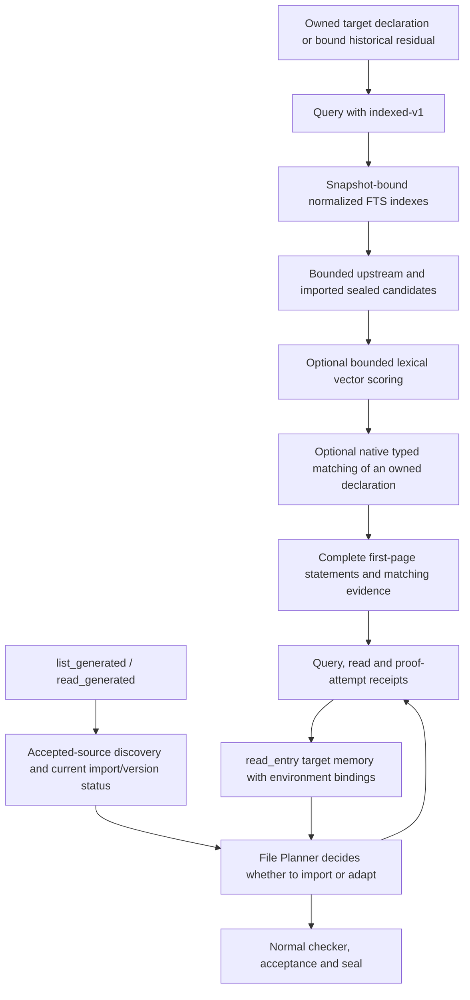

# Long-task premise retrieval

The document harness supports bounded indexed retrieval, generated-source
visibility descriptions, and target-bound usage evidence. These are separate
from proof acceptance. Existing requests retain `legacy-v1`; a new strategy is
selected explicitly so old query receipts cannot silently change meaning.



## Indexed candidates and native matching

The existing `proof_action` query supports:

```json
{
  "action": "query",
  "request": {
    "goal_query": true,
    "context_entry_id": "fixed-or-accepted-entry-id",
    "retrieval_policy": "indexed-v1",
    "candidate_budget": 50,
    "structural_rerank": true
  }
}
```

`candidate_budget` is 1–500 and defaults to 100. These are configurable execution
bounds, not trained or experimentally optimal thresholds. The first page remains
five complete records. Exact and definition lookup retain their existing rules.

`indexed_retrieval.py` builds independent indexes bound to upstream database or
generated-projection bytes. Index and query use the same identifier-token encoding.
FTS first produces candidates; optional hash-vector scoring reads only their
vectors. Generated proof examples must still have a matching proof digest and
commit, and ordinary generated candidates come only from the caller's legal
sealed projection. Building an index reads the corpus, but a later query does
not score every record. This is an index design, not a query-result cache.

The optional callback can only permute the bounded union; it cannot add a fact,
change a statement, or grant proof authority. `premise_structure.py` elaborates
the harness-owned declaration with checked imports and owned context, uses
Isabelle `Pattern.match` on typed terms, and records:

- `conclusion_match`: a rule conclusion matches a goal; instantiated premises
  remain outstanding.
- `rewrite_match`: an equation's left side matches a goal subterm.
- `no_direct_match`: neither of those limited matching routes was found.
- `unresolved`: the name was not resolved or an observation operation failed.
- `catalog_mismatch`: the resolved native proposition differs from its supplied
  native catalog digest.

Matches never certify applicability or close goals. In particular, indirect
lemmas, reverse rewriting and more elaborate instantiations can be useful despite
`no_direct_match`. Native matching observes imports and the owned declaration;
it does not replay an arbitrary in-progress proof prefix. Historical printed
residuals retain lexical retrieval and report `unsupported_historical_residual`.

Each native call has an independent output directory, checked-source identity,
and output-byte digest. Failed native observations retain lexical candidates
with explicit diagnostics. Contradictory or incomplete protocol output is rejected.
New indexed queries bind effective budgets, index versions and implementation
hashes in their query identities. Legacy identities remain unchanged.

## Discovery and current visibility

The existing `list_generated` and `read_generated` now describe the assigned
theory's accepted environment without adding a public tool parameter. Discovery
includes accepted sources outside current imports. Pending contracts are not
returned as proven facts.

The added `visibility` distinguishes accepted-but-unsealed sources, sealed
sources requiring an import, imported providers with matching versions,
unversioned older bindings, and historical source versions requiring rechecking.
It includes actual import-closure membership, commit/seal identifiers, and
whether source contents still match the current accepted source.

`environment_id` binds actual imports, provider versions and accepted prefix.
Draft imports do not change it. An unrelated feedback commit does not invalidate
it. All results remain `reference_only`, with
`native_availability_checked=false` and `applicability_checked=false`. Reading
a source never imports it; normal import validation and checking remain required.

## Target memory and use evidence

`read_entry.retrieval_memory` restores new query bindings and exposes
`usage_evidence`:

| Evidence | What is established |
|---|---|
| Returned candidate | A query bound to this target returned its identity/version. |
| Explicit fact read | A successful read expanded that record. A read without a target remains unattributed. |
| Attempt mention | A hash-bound historical proof attempt contains the fact-name token. |
| Accepted proof mention | The currently accepted proof text contains that token. |

Textual mentions are explicitly **not** native dependency or necessity evidence.
Comments are excluded, and ambiguous short names are not resolved by guessing.
Failed attempts never create permanent negative labels.

Bindings include target identity, environment revision, imports, provider
versions and accepted-prefix identity. Old records without those bindings remain
unknown. Changes to target text or environment mark historical observations;
retired facts are never repopulated into the current fact cache. Completed
historical receipts remain addressable after restart and import revisions.

Displayed queries, related-query contexts, reads, attempts and mentions have
record-count bounds, totals and continuation or exact-proof read actions. Full
statements and proof artifacts are not abbreviated to meet those bounds.

## Fast validation

The earlier lexical laboratory remains available:

```bash
python3 -m regen.tools.premise_retrieval_lab --output /tmp/lexical-lab-new --noise-records 0
```

Compare legacy full-vector scanning with bounded candidates at several corpus
sizes and budgets:

```bash
python3 -m regen.tools.indexed_retrieval_smoke --output /tmp/indexed-lab-new
```

Run native type, implication, rewrite, locale, digest and query-pipeline checks:

```bash
python3 -m regen.tools.premise_structure_native_smoke \
  --dataset reports/regen/refine-astra-effective6h-20261027-001/dataset \
  --output /tmp/premise-native-new
```

The native smoke adds explicitly authored fixture declarations before rendering
the checked source. It uses prepared heaps read-only, makes no model calls and
publishes no benchmark GREEN results. Every output directory must be new.

Relevant fast regression modules are `test_indexed_retrieval`,
`test_premise_structure`, `test_premise_visibility`, `test_retrieval_usage`, and
`test_retrieval_recovery_controller` in `regen.tests.current`. Visibility tests
use real journal/controller paths with a synthetic checker. Usage tests include
cold recovery, import changes, same-ID target changes and 120-event histories.

These checks establish implementation behavior and boundaries. They do not
measure repository-level proof success or justify universal ranking claims.
