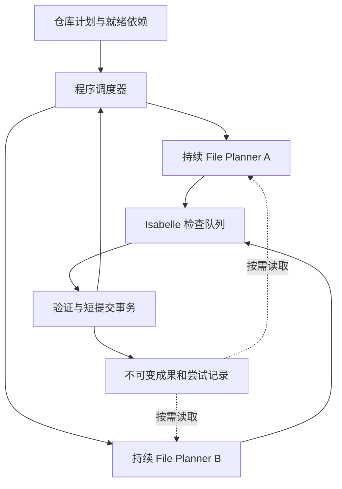

# 持续 File Planner 的并行方案与实验

> 2026-09-25：当前仅在不同 theory 之间并行，单 File Planner 的读取/检索/检查均串行等待，接口功能保留。本文实验与基线分析保留历史内容；当前行为以 [整体流程](../design/PARALLEL-PROOF-PIPELINE.md) 和 [实现记录](PARALLEL-PIPELINE-IMPLEMENTATION.md) 为准。

历史基线（2026-09-24）：当时方案已确认、尚未启用生产并行，代码为 shared-proof-workspace / 7c4b96b。当前 `parallel-workspace` 已支持跨 theory 并行；默认源码接口与验证状态见上述主文档。
研究与本地实验记录：reports/analysis/parallel-file-planner-design-20260924/。
已确认的端到端模块责任、代码 TODO 与 A/B/C 实施批次统一见 [流程主清单](../design/PARALLEL-PROOF-PIPELINE.md)；本文维护并行选型实验和资料依据。

## 推荐架构

程序调度器 + 每个活跃 theory 一个持续 File Planner + 独立 Isabelle 资源池 + 不可变共享成果。
首次候选配置：两个 File Planner、至多两个模型请求、一个 native 检查槽；再实测两个 native 是否值得。
模型统一 gpt-6-astra / medium。资源上限不限制证明尝试、helper 数量或数学路线。
不在每个证明动作之外增加一次总控 LLM 调用。



## 所有权、分组与会话

- 每 theory 单一写入者；可由统一调度器保证。共享冻结父环境，隔离各 theory 的源码、ROOT、日志和可写 heap，无需复制整个仓库与数据库。
- required_imports 决定启动条件；priority 只在资源不足时排序。协作组不创建额外 barrier。
- 分组兼顾共享语义/helper、可处理规模、跨 theory 等待和 seal 成本；不是拆得越小越好。
- 当前默认源码模式：每个 agent 持续编辑自己的 `.thy` 草稿，维护已接受版本、检查反馈和工作笔记；无需维护证明 DAG。模型可一次填写多个证明，不为每个声明重启会话。旧图接口仅作历史兼容。
- 首版采用非抢占的 theory 任务所有权：agent 正常持续负责到 seal；完成后立即补入下一个 ready theory，不等待整批 worker。theory 内可自由切换 contract、创建 helper、调整路线；不因失败次数、时间片或主观收益判断主动迁移到其他 theory。
- 当前接口串行返回：同 theory 的编辑、读取、检索、检查完成后才进入下一次操作；其他 theory 的 agent 可同时工作。内部执行池用于持久任务和资源限流，不表示同一 agent 能一边检查一边编辑。历史方案曾允许异步提交后继续独立工作，该行为已撤回。
- 同 theory 不允许多个在途候选；默认通过 `edit_theory` 批量修改源码，再用 `check_theory` 按文件顺序验证。旧 `submit_batch` 图补丁接口不对默认源码 agent 开放。
- 持续逻辑状态不意味着全部 theory 都常驻进程；按就绪任务懒启动，基础设施故障或用户中断后保留恢复材料；这不构成数学探索中的主动让出机制。provider 会话恢复能力需单独验证，不能假定临时 Codex home 删除后仍能恢复原线程。

## 共享成果与验证

| 来源 | 获取方式 | 可信边界 |
|---|---|---|
| 当前 theory | 直接工作区与完整正文读取 | GREEN 可按合法前缀引用；候选仍需检查 |
| 其他 theory 未 seal 的 GREEN helper | 简短索引、固定 commit/source_ref、完整依赖闭包 | 可参考或复制到目标复验，不自动转移 GREEN |
| 失败草稿 | 显式读取尝试和反馈 | 仅参考，不是前提 |
| 已 seal 且合法 import 的成果 | 固定成果版本 | 可在对应上下文引用 |
| 父 session 大型前提库 | SQLite exact/name/search/goal 检索 | 命中仍需适用性验证 |

已知成果优先直接读取，不强迫所有复用都经过向量召回。不广播全部正文或所有 agent 的聊天记录。
部分 theory 快照导入留作后续单独实验，需证明依赖闭合、版本冻结、上下文合法和集成一致。
不能直接删除 seal 门槛后导入任意可变工作文件。

## 鲁棒性与低开销

程序调度器发布全局状态。请求绑定 theory、来源快照、请求 ID、候选哈希；模型生成和 Isabelle 执行不占全局提交锁。
验证结果只在快照匹配、证据合法时提交。保留现有完整 seal 与仓库集成验收。
请求先记录再派发，结果先保存再返回；丢响应时查询原结果，不能默认再次生成或再次提交。
只承诺逻辑提交去重；崩溃时无法判断旧检查是否完成，必须恢复/核对，不能无依据保证物理执行恰好一次。
共享读取取得固定已发布快照，不修其他 theory 的 HEAD，不因追加交错误判历史损坏。
模型笔记辅助恢复，不能覆盖 proof、imports 和证据的权威记录。
每 worker 保存独立状态，由调度器汇总。只记模型生成、排队、检查、GREEN/RED、seal、恢复等状态变化，不写周期心跳。
大正文和日志保留一份并引用；不在 prompt、反馈与汇总里反复展开，不每步扫描重建全仓日志。

## 小实验和选择标准

| 实验 | 做法 | 决策用途 |
|---|---|---|
| E0 并发正确性 | 临时目录调用真实锁、journal和不可变发布函数，用确定性屏障注入交错 | 确定开放并行前必须修改的共享状态 |
| E1 native 资源 | 合法历史候选在独立目录串行/双 worker 回放，区分冷启动与热前缀 | 比较检查吞吐、RSS、CPU、超时，选择 native=1 或 2 |
| E2 小目标生成 | 同一五 contract 测试任务，比较单共享agent、双会话单模型槽、双agent并行 | 分开衡量上下文拆分成本与并行收益 |
| E3 成果复用 | 相同五个对象访问目标，固定并发后比较同组/拆组与复制复验 | 识别探索顺序、分组和复用收益 |
| E4 故障恢复 | 在派发后、验证后、返回前注入中断/丢响应，加入慢任务 | 验证恢复、去重和调度补位 |

E1分别测量父环境加载、热前缀候选验证和完整seal/build，不将不同阶段混成同一检查时延。

E2使用 whenE_throwError_corres'、gets_the_noop_corres、drop_spec_corres、use_spec_corres'、zipWithM_x_corres。
实验固定为2+3两个theory，仅检验调度，不代表生产分组推荐。这是新五目标微型 benchmark，不改变287目标计划或冒充完整原theory成功。
四配置：A单共享agent/model1/native1；B双theory agent/model1/native1；C与B相同但model2；D与C相同但native2，D由E1结果决定。
A保留单共享agent基线的跨theory选择能力；B/C/D采用持续theory所有权，不主动迁移未完成任务。这一调度差异必须计入对照解释。
B只有模型请求串行，检查与另一会话的生成可以流水重叠；A/B同时改变上下文所有权和调度方式，不能称为纯上下文成本对照。冻结其他设置后，B/C才隔离模型并发槽的影响。
先一组对照排除协议错误，再给候选补至少两组配对运行、交替顺序；记录所有未完成结果，不只挑成功样本。
E3固定目标为 setObject_other_corres、getEndpoint_corres、getNotification_corres、setEndpoint_corres、setNotification_corres。
更改分组必须新计划/benchmark身份、精确声明/context不变、重新预检，不同时改变模型、数据库和checker。
所有从零生成实验禁止携带旧 GREEN、VERO proof bodies 和旧目标专用 helper；E1仅为明确标记的检查器回放。

测量：相同目标全部seal的墙钟、首次GREEN、模型/传输等待、检查排队/执行、初始化/恢复、token、资源峰值、复制复验成本、最终覆盖。
并行时间按区间统计，不把worker时长相加作为墙钟；记录实际provider请求，不以外层决策数冒充模型成本。
正确性要求：无丢失GREEN、重复逻辑提交、过期结果接受、非法前提接受。
建议选型门槛：正确性和覆盖不下降，配对中位墙钟降低至少20%，模型token增加不超过20%；这是待测工程准则，不是模型限制或已实现收益。
若C有效D无效，选双agent/单native；若简单目标加速而E3变差，优先调整分组/共享，不继续加worker。

## 实施顺序

1. 一致快照读取、theory所有权、每worker日志、短事务发布与native限流。
2. 程序调度器接入两个独立持续会话，复用现有batch验证与seal；保留单共享agent基线。
3. 增量共享索引、基础设施/用户中断恢复，保留现有helper复制复验；首版不实现主动跨 theory 让出。
4. 新增独立的全仓库覆盖、统一构建与 integration gate；局部 seal/status complete 不等于仓库验收通过。
5. 实测需要后再单独考虑未seal部分快照；不先增加多层模型评审或每步总控。

历史阻塞（2026-09-24）：当时全 run 锁、单一 monitor 和 journal 读取包含串行假设，不能只删除 flock 后启动两个命令。当前由一个 `parallel-workspace` 协调器持有 run 锁，内部各 theory 控制器独立执行；该锁防止重复 runner，不会串行化内部 agent。native 槽单独限流，默认 `native_slots=1` 时 Isabelle 检查仍会排队。
软件工程参考：
[OpenAI Subagents](https://learn.chatgpt.com/docs/agent-configuration/subagents)、
[Worktrees](https://learn.chatgpt.com/docs/environments/git-worktrees)、
[长程任务](https://developers.openai.com/blog/run-long-horizon-tasks-with-codex)、
[Anthropic长程harness](https://www.anthropic.com/engineering/effective-harnesses-for-long-running-agents)、
[并行C编译器](https://www.anthropic.com/engineering/building-c-compiler)、
[Cursor并行agent](https://cursor.com/blog/scaling-agents)。
这些是实现文档和厂商工程观察；可借鉴隔离、持久状态与降低协调成本，不能据此预测本项目加速倍数。

## 调度调整的理由与边界（2026-09-24 补充）

软件工程中，跨文件编辑常常属于同一个任务；会话交接也不等于为了全局最优而抢占未完成任务。上述 Anthropic 长程 harness 文章支持持久状态和增量完成任务，Cursor 文章说明全局协调与长持锁可能带来成本；这些资料不能证明按数学收益主动跳出 theory 有益。首版撤回主动让出的建议，先测量独立 theory 的并行。

全局程序只维护依赖、任务状态、所有权、资源占用及成果引用；证明正文和推理历史留在本地工作区，按需读取。等待 Isabelle 时保留 theory 所有权，但不占用模型请求槽或全局提交锁；检查任务仅在实际执行时占用 native 槽。普通证明失败由本地 agent 继续处理，不自动触发跨 theory 调度。无法完成时如实记录未完成状态，不把它当成 seal。

历史状态（2026-09-24）：当时仅更新设计，旧 batch 控制器仍有 pause，workspace 仍为单 agent。此描述不适用于当前 `parallel-workspace`：当前每个活跃 theory 一个持续 agent、正常工具串行，普通证明失败不提供 pause 动作。当前 Isabelle 调用和并发边界以 [整体流程 M6](../design/PARALLEL-PROOF-PIPELINE.md#m6) 为准；[旧 checker 接口分析](ISABELLE-CHECKER-INTERFACES.md)保留历史诊断。

## 显式恢复阶段与有限重试（2026-09-29）

`parallel-workspace --execution-policy PATH` 可读取以下 JSON，并将完整内容冻结在
新运行的 `parallel-workspace-policy.json` 中：

```json
{"stages":[["Translation_Lookup","Fault_Marshalling"],["Scheduler_Queues","Capability_Access"]],"session_stall_retries":1}
```

阶段内仍按空闲槽位滚动调度，不是固定两项一批的通用调度策略。只有显式配置
的阶段存在屏障：前一阶段结束且其 agent 清理完成后，才允许后一阶段。
前序未完成或重试耗尽时，后续记录 `priority_stage_incomplete`，不绕过失败。
指定阶段全部结束后，恢复所选 theory 的通常调度与最终 repository integration。
缺省无阶段屏障，也无自动 SessionStalled 重试。

`session_stall_retries` 是本次协调器执行中每个 theory 的额外重试次数（0–3）。
仅 `SessionStalled` 可自动重试；清理失败、配额错误和普通证明失败不在其列。
每次重试创建独立会话目录，保留失败记录、已验收成果、草稿与已计费请求，
不重放半个工具调用。监督服务仍 `Restart=no`，一次启动收据禁止重复启动同一运行。

900 秒须由新运行显式传入 `--call-timeout 900`，不修改既有运行或全局默认值。
该参数同时控制协议事件静默和进展时钟，工具原生执行时间不计入进展停滞；
连续八次重复结果的独立保护不变。`--check-timeout` 和 `--candidate-timeout`
各自独立。封存构建现用独立目录中的 `Sealed_Refine` 子会话，不再改写
`Generated_Refine` 依赖会话，避免失败封存删除正在使用的父 heap。
