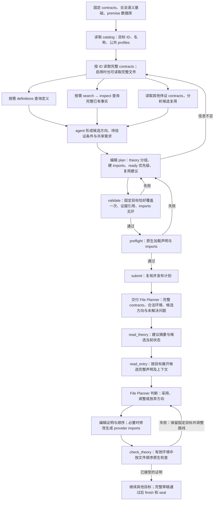

# 规划输入、顺序与候选复用

2026-11-02 修订。本文讨论当前 Repository Planner 的输入、候选复用与规划交付，并记录当前 document 路径的生成期 imports 修订机制，明确区分已实现能力和建议。

## 已实现的输入简化

- `catalog.json` 的目标条目只含 `contract_id`、`name` 和可见性策略允许的 `owner_theory`，公共 `context_profiles` 放在顶层字段。没有完整命题、局部上下文或词法特征。
- `contracts ID...` 返回固定完整声明、owned context、属性和允许的 owner。允许直接文件读取时，`contracts.json` 提供相同的完整目标视图。
- `principal_symbols`、`logical_shape` 已从新 contract cards 和当前公开规划视图删除。加载旧数据时也重新生成最小目录，避免旧字段回流。旧实验产物不重写；旧版 premise 数据库格式中的历史字段不属于当前 v2 规划输入。
- `related` 已从 CLI、通用工具 schema、提示词及 workspace 服务删除。不再自动生成共享符号候选；兼容数据结构中的 `contract_relation_candidates` 对新准备输入及当前公开视图为空。
- 保留方案输出的 `contract_relations`。这是 agent 使用已检查事实支持的语义关系，和已删除的词法查询不是同一个概念。
- 当前目录读取仍为全量最小目录；目录分页、目标全文搜索和原生规范常量索引尚未实现。

## 当前执行路径的更正与本页范围

此前流程图把旧执行路径的独立 GRA 阶段混入了当前 document 流程，这是错误描述。当前 `proof_session_runner parallel-workspace` 默认 `file_planner_interface=document`，进入 `parallel_file_planner.run_parallel_workspace`。持续运行的 File Planner 通过 `edit_proof` / `edit_theory` 修改证明、helper 和顺序，接收检查反馈后继续处理；`generic_codex_agent` 复用相同 document controller。

仓库中仍有旧 `run-file` / `run-session` 和 `graph_revision_agent` 代码，但不能据此给当前流程加一个独立 GRA 节点。本次清理修正文档，不删除旧模式实现。原来关于“File Planner 只规划一次、之后只能由 GRA 修订”的主文档描述也已修正。

`proof_references` 属于证明生成后的证据查询，本轮不实现。下图包括向 File Planner 交付候选方向与读取当前候选状态；证明检查仍使用原有生成流程。

## 规划流程



定义查询、事实查询和待证目标比较按需进行，并非三项都必须逐目标完成。`preflight` 使用声明检查，不证明目标，也不认证每条候选路线可行。`submit` 仍复核提交内容，不能用旧方案的成功结果发布不同方案。

## contracts ID 与此前拟议 contract_environment 的区别

| 能力 | 当前 contracts ID | 此前拟议 contract_environment |
|---|---|---|
| 原始完整声明 | 已返回 exact_statement | 重复使用相同声明 |
| 固定局部上下文和属性 | 已返回 contract_owned_context / attributes | 在 Isabelle 中重放它们 |
| 名称、声明种类、可见 owner | 已返回 | 没有必要重复提供 |
| 公共 context profiles | catalog 顶层提供，目标没有永久指定 profile | 选择环境做一次原生观察 |
| 原生名称消歧、类型、解析后目标与假设 | 详情本身不进行原生观察 | 这是拟议的新增能力，尚未实现 |
| “该 contract 在功能上做什么” | agent 阅读命题、上下文与定义后判断 | 原生解析不会自动给出功能解释 |

因此，理解一个 contract 直接使用现有 `contracts ID` 即可；不清楚的操作或谓词继续用 `definitions` 查看，必要时 `search` / `inspect` 已有事实。此前将独立环境接口表述成理解目标的前置步骤并不必要。

当前建议不新增独立 `contract_environment`。若将来实测发现名称歧义、隐含类型或 locale 解释影响规划，再考虑给现有详情增加按需原生观察能力；它不应承担自动推荐路线或解释功能的职责。未发生这种需求前，不增加一层缓存句柄与工具调用。

现有多 profile 检索仍有独立的实现限制：v2 查询验证 profile ID 后查询已准备好的基础库，并不是按不同 profile 做精细过滤。若后续支持多环境数据集，应完善实际查询范围；改接口名字或增加 ID 不能替代过滤实现。

## 规划应允许选择待证 contracts 作为候选 provider

候选来源包括两类：

- 已有事实：由 `search` / `definitions` 找到并经 `inspect` 读取完整命题。
- 待证 contract：由 `contracts A B ...` 读取准确声明和上下文，agent 推测 A 完成后可能帮助 B。

选择待证 A 作为候选不要求先证明 A。记录的是“如果 A 成立并且满足适配条件，B 可以尝试利用它”；这不把 A 加入当前已证 premise 集合，也不宣称 B 的证明路线已经成立。候选由 agent 分析合法输入后产生，不由 harness 自动按词法重合配对。

v6 proposal 现支持可选的顶层 `proof_direction_suggestions`。每条建议针对一个固定目标，可以引用多个已 inspect 的合法 premise 和多个待证 contract；同一目标可以有多条备选建议。例如：

```json
{
  "proof_direction_suggestions": [{
    "id": "direction_B_from_A",
    "target_contract_id": "C_B",
    "direction": "尝试实例化 A，再用它建立 B 所需的 Q t",
    "candidate_premise_ids": [],
    "candidate_contract_ids": ["C_A"],
    "open_questions": ["如何建立 A 所需的 P t", "B 的上下文是否满足实例化条件"]
  }]
}
```

这里的 provider/consumer 有明确方向。若 A 是 `P x ⟹ Q x`，B 需要 `Q t`，候选方向可以写成“尝试实例化 x 为 t 后复用 A；尚需建立 P t”。规划阶段不必证明 `P t`，也不必保证这条路线成功。

当前 schema 可以承载的内容：

| 字段 | 当前粒度及边界 |
|---|---|
| collaboration_groups | contract IDs；表达值得共同探索，不规定有向证明依赖 |
| reuse_suggestions | theory 的 provider、consumer、reason；不是 contract 级结构化有向记录 |
| contract_relations | 两端 contract IDs 和语义关系，要求已 inspect 的证据；不是自由填写无证据猜测的字段 |
| helper_decisions / purpose / grouping_reason | 已有事实复用、共享辅助意图及分组理由 |
| proof_direction_suggestions | contract 级可选方向、候选 premise/contract IDs 与尚未验证的问题；不是事实或强制证明依赖 |

提交时检查建议 ID 唯一、target/candidate contract IDs 属于固定集合、没有自引用或重复候选、premise IDs 已 inspect 且来源合法。方向内容和适配条件不由这些结构检查证明。建议可以形成探索上的环，因为它们不生成硬 imports 或调度依赖。省略新字段的旧 v6 proposal 保持原产物与摘要，不静默添加空建议。

建议随已绑定的 repository plan、文件列表和目标所属 theory 投影交付；harness 根据固定目标与新分配派生候选完整声明、owned context、生成 provider theory，并保留候选 premise 的完整已检查记录。它们进入独立的建议信息，不加入 `parent_premise_ids`、已证事实集或接受日志。NOTES 仍是说明材料，不能假定它自动成为正式输入。

## File Planner 如何处理方向建议

`read_theory` 返回可选 `planning_advice` 摘要与候选状态；`proof_action(read_entry, entry_id)` 展开该目标的候选完整声明和上下文。已有 helper 意图和 theory 级复用建议也通过此视图交付。读取时根据同一次运行的固定包、当前接受快照、草稿顺序和已生效 imports 重新计算状态，仅读取有关候选，不为其他 theory 启动原生 worker。

两个判断必须分开：

- **是否已有合法可见证明**：由 `authority_status`、`visibility_status`、`can_use_as_current_premise` 描述。未证目标、未知处置和已反证目标均不能成为正向事实。同 theory 已证候选还须位于目标之前、认证前缀保持有效；修改顺序或证明后需要重检。外部 GREEN 但尚未认证导出只作参考；已经导出但未进入有效 imports 的候选也不能直接使用。
- **是否适用于当前目标**：`applicability_verified=false`，不会因为候选已证明就自动变为 true。实例化、局部前提和真正的证明作用由 File Planner 分析，并在普通 Isabelle 检查中验证。

File Planner 可以采用、调整或放弃任一建议，不要求填新的强制决策表。建议候选尚未 GREEN 也不阻止尝试：同 theory 可以在同一批次中先证明 A 再证明引用 A 的 B；保留 `oops` 的 A 不会导出 theorem。跨 theory 需等待合法认证导出后选择导入，或放弃该路线继续独立证明。某条建议失效不撤销、弱化或删除其固定目标，也不把所有候选变为必须先完成的依赖。

建议状态是读取时的观察，不是持久授权票据；后续编辑或 imports 修订可能改变它。原生检查继续以实际源文件、当前环境和接受日志为准。没有新增假设未证 contracts 的普通证明路径，也没有新增 GRA 阶段。

实现入口为 `planning_advice.py`、`import_contract.py` 和 `parallel_file_planner.py`。验证记录在 `reports/regen/proof-direction-handoff-audit-20261102-001/`：200 项相关回归通过；`regen/tools/proof_direction_native_smoke.py` 的三个合成验收通过。原生负例直接引用未证 `False` 候选会得到 `Undefined fact` 且没有 GREEN；随后同批证明 `True` 候选和使用它的目标可以接受，原来的 `False` 固定目标继续保留为 open。该验收没有模型调用，不代表方向建议提升了模型证明成功率，也没有完成 benchmark 的证明任务。

## check_reuse 的定位修正

此前设计只接受已证明事实，并执行一次 native resolve，主要检查“这条现有事实能否作用于目标”。它没有覆盖当前更重要的“哪些待证 contracts 值得一起规划或先后证明”。

当前建议不把原生 `check_reuse` 作为规划必需步骤，也不新增它。第一步先把候选 provider/consumer、理由和剩余问题表达清楚，交给 File Planner 在证明生成阶段检验、采用或放弃。

以后如需增加可选的适配分析，输入应能显式区分 `existing_fact` 与 `pending_contract`：前者可引用合法的原生 theorem；后者只能做命题匹配或明确标记的假设性分析。即使在临时上下文假设 A 后检查出 B 的条件步骤，也只能说明条件关系，不能证明 A，不能发布 B，更不能把 pending A 写进合法 premise 库。这种分析不必成为所有目标的规划门槛。

失败后可以撤回或更换的是候选复用和证明路线，不是删除或弱化固定 A/B 目标。具体失败处理属于 File Planner，本页不再展开生成期流程。

## 顺序与跨 theory 的边界

| 关系 | 当前含义 |
|---|---|
| required_imports | 初始硬可见性与启动依赖：等待 provider 认证导出；当前 document 路径可通过后续已验证 imports 事件修订有效导入 |
| theories 数组顺序 | 已满足硬依赖的 theory 之间的 ready 优先级 |
| collaboration / reuse 建议 | 探索意图；不授予可用事实，也不自动创建启动屏障 |

待证 A 与 B 放在同一 theory 时，可作为 File Planner 的局部候选关系，后续依据结果调整声明顺序和证明。跨 theory 时，单写 reuse_suggestions 不会让 A 自动进入 B 的合法环境；确实需要 A 的结果时必须有相应硬 import。硬边引入等待 provider 的约束，不应由未经检验的候选关系自动生成。

接受后的 theory 分配保持不变，File Planner 不能移动固定 contract。当前 document 路径允许尚未认证导出的 theory 在草稿中累计增删生成 provider imports，在下一次原生操作前验证并应用最终列表。初始硬 provider 尚未就绪仍会阻塞首次启动；动态 imports 不承诺自动修复所有规划失误。

原始 `imports.json` 和规划投影保留为初始绑定，不原地覆盖；当前有效导入来自验收日志中的 `context_imports` 与 `context_revision`。旧运行和旧图执行模式的既有证据仍按原绑定重放，不能把修改新实现当作给冻结旧运行静默迁移。

## 生成期 imports 修订与 seal（当前 document 实现）

每个 theory 保留自己的工作区和 File Planner。imports 编辑只修改草稿；多次增删可以抵消，不逐次构建环境。下一次需要原生上下文的操作统一应用最终列表，最后由 `finish` / `seal` 完整认证。证明失败返回同一 File Planner。

当前仅允许尚未认证导出的 consumer 修改生成 provider imports；新增 provider 必须属于同一运行、已有合法认证导出，并绑定其 seal/commit 版本、检查依赖无环。基础定义、toolchain 和固定 contracts 不改变。已有完整或部分认证导出的 theory 不允许原地修改。

还有一项当前边界：如果该 theory 已接受原生反证，暂不允许再改变 imports，因为反证证书绑定其认证环境，当前没有跨环境重新认证反证的协议。此时应用 imports 会立即返回具体诊断，旧状态保留；普通 `unknown` 处置不限制 imports 修订。`check_refutation` 自身也会先应用待处理 imports，再在实际生效环境中检查。

`edit_theory` 支持如下独立更新形式，`imports` 与 `source` / `edits` 三选一：

```json
{
  "action": "edit_theory",
  "base_sha256": "read_theory 返回的当前草稿摘要",
  "imports": ["Generated_Refine.Regen_Provider"]
}
```

列表是完整且有序的期望导入。无生成 provider 时使用该运行的基础 import 单元素列表；有 provider 时使用其规范 `Generated_Refine.*` 名称，基础语义通过 provider 闭包保持可见。`read_theory` 的 document 返回 `draft_imports`、`checked_imports`、`imports_pending`；顶层 `import_options` 给出 `base_import` 和指向 `list_workspace` 的 `provider_directory`，避免每次读取草稿都扫描全仓。`list_workspace` 各行及外部 theory 读取的 `import_option` 给出 `import_name`、`exports_available`、`seal_id`。这些选项仅供选择，实际应用时再次验证 provider 并绑定其 commit。

读取草稿、编辑证明和普通历史读取不应用待处理 imports。`check_theory`、sketch/probe、符号解析、可能进行原生解析的查询以及 `finish` 等原生操作，在执行前经过同一边界：

1. 比较最终草稿列表与当前有效列表；相同则不创建 imports 修订。
2. 准备候选 checker/session，检查 provider 版本、来源与无环条件，并原生比较前后固定目标及局部假设的 typed term 身份。候选环境失败时保留旧认证状态和草稿，返回诊断。
3. 验证通过后追加 `imports` 验收事件，推进 `context_revision`，更新有效 `context_imports` 与 provider 版本。原始 `imports.json` 保持不变。
4. 清空当前已认证 prefix/证明集合和旧上下文的查询投影；证明文本、历史认证及已消耗成本保留在草稿和不可变日志中。旧 prefix 不作为新上下文的证明依据。
5. 更新当前 checker、生成事实闭包与查询缓存，继续执行原操作。只有在新环境中重新检查的证明才能重新进入当前 GREEN；不要求 agent 传入新的 environment_id。

sketch 流程中的失败修复要求和短 probe 次数也按 imports 的适用环境区分。切换环境不删除旧收据、不退回已消耗的运行成本；切回同一 imports 时仍保留该环境已经使用的诊断次数。

`finish` 的流程为：

```text
当前 imports + 完整证明草稿
    → 原生重检（必要时先完成待重检证明的重新认证）
    → 完整审计与构建
    → 成功：发布绑定当前版本的 seal / exports
    → 证明失败：反馈给 File Planner，修复后重试
```

普通 document 的 `finish` 要求当前草稿摘要匹配且没有 open slot；草稿尚未检查成功时，先执行完整草稿检查，成功后继续 seal，失败返回 File Planner 而不发布。`baseline` 同时比较上下文版本和 imports，禁止跨环境复用旧前缀。完整或部分导出的额外条件仍由对应策略检查。

证明脚本因新环境产生的失败交给 File Planner 修复。导入循环、未认证 provider、基础设施失败和固定目标解释变化须分别诊断，不能都伪装成待修的证明失败。seal 成功前不发布该新版本的可用事实；旧文本仍可作为带版本的参考。

删除 imports 采用同一流程。没有显式引用只是删除候选理由，是否仍依赖其定义、类型或自动化环境由新环境下的检查决定。可以连续修改草稿和 imports 后再做最终完整复验；普通查询仍使用已生效环境，待导入内容不能被误标为当前可用事实。

普通 generated premise query 按当前有效导入闭包检索；imports 事件接受后更新相应 `sealed-premises.json` 投影。跨 theory 发现继续通过 `list_generated` / `read_generated` 读取参考；File Planner 可据此选择已认证 provider 的导入选项。未认证内容仍只作参考，本次没有增加自动全仓事实推荐器。

实现入口为 `theory_document.py`、`parallel_file_planner.py`、`import_revisions.py`、`import_semantics.py` 和 `batch_file_planner.py`。取消、重启及投影恢复以不可变验收日志为准；旧环境的观察回执不能重新注入当前上下文。

可用 `regen/tools/dynamic_imports_native_smoke.py` 复现原生验收。它从指定 dataset 读取合法 checker context，构造三个合成 theory，验证增删、首次检查、完整草稿 finish、发布后不可变和仓库 integration。运行时须选择新的输出目录，例如：

```sh
python3 -m regen.tools.dynamic_imports_native_smoke \
  --dataset intervaltree/build/a-v2-preflight-20261101-001/dataset \
  --output /tmp/dynamic-imports-smoke-new
```

该脚本不调用模型；合成目标与动作来源资格在报告中明确披露，原生 Isabelle 检查、验收日志、seal 和 integration 保持真实。其成功不代表完成 Intervaltree 或其他 benchmark 的全部证明。

## environment_id 是什么，以及何时变化

它是上一版设计提出的原生观察/检查快照句柄，不是当前规划接口已有的必填参数，也不是 contract ID 或 profile ID。原设计把目标声明和实际上下文一起绑定进去，因此叫 environment_id 容易误以为它只标识一个公共环境。

其原本目的只是防止把旧上下文中的解析/适配结果误用到另一个上下文，不是给 contract 提供新语义。对于本轮固定输入的规划，harness 已通过 `control/input-binding.json` 绑定输入摘要、premise DB 摘要和 checker identity；原生预检还有 `checker_context_id`。agent 不需要在普通 contract 查询中反复传同一个句柄。

因此撤回新增公共 environment_id 参数的建议。若将来增加原生观察或可选适配分析，harness 可在内部根据 contract ID、选择的合法 profile、候选身份及固定输入计算缓存/回执绑定，并在使用时自动核对。

| 变化 | 对原生观察或适配结果的影响 |
|---|---|
| 固定声明、owned context、相关属性改变 | 新输入身份；旧目标结果不再直接复用，当前 run 内不允许暗改固定目标 |
| 选择不同合法 profile、实际 imports 或基础定义改变 | 环境绑定改变，重新检查；不按 owner 猜 profile |
| Isabelle、checker 或提取器版本改变 | 重新确认对应原生结果与回执 |
| premise DB 内容或身份改变 | 检索/适配缓存重新绑定；不等于旧数学命题已被证伪 |
| 从 A 换到 B，或更换候选事实 | 使用新的目标/候选请求键；不意味着共享基础环境本身改变 |
| 只改分组理由、NOTES、查询次数、ready 优先级 | 不改变目标语义环境，不应使原生目标缓存自动失效 |
| 修改分组且因此改变实际 imports | 按实际环境变化处理，不能仅看理论名称是否相同 |

同一次冻结规划中普通读取不会让这些绑定不停变化。“失效”在这里表示旧证据不再覆盖新请求，需要重查，不表示目标或事实变成假。

## 本次清理与验证范围

- 从本页移除独立 GRA 节点与生成期引用查询流程，修正主规划文档关于 File Planner 只运行一次的旧描述。
- 不新增 contract_environment、check_reuse 或 environment_id 公共参数；proof_references 不属于本轮规划方案。
- 清理 prompt_v6 中删除 related 后残留的 returned relation 证据示例，保留 inspected parent-premise ID。
- 已完成的 principal_symbols/logical_shape/related 删除实现保留；此前 85 项相关测试及真实 287-contract 离线输入检查的结论不扩大为新接口或新实验的验证。

先前的接口清理之后，当前 document 路径实现了惰性 imports 修订和 finish 复检；本次再补齐可选 contract 方向建议及其 File Planner 消费路径。单元测试与原生验证以相应实际运行记录为准，不把此前 85 项删除回归当作动态 imports 或方向建议的验证。本轮没有删除旧执行模式代码。
